# 24. Трассировка лучей (режим RTX)

> Модуль `render`, таргет `Oxwald::render`, пространство имён `ox::render::rt`. Заголовки — `<oxwald/render/features/raytracing/raytracing.hpp>` (настройки, статус, регистрация), `rt_api.hpp` (интеграция), `rt_scene.hpp` (BLAS/TLAS на CPU), `denoiser.hpp`, `ddgi.hpp`. Низкоуровневые BLAS/TLAS — [глава 17](17-rhi-vulkan.md).

## Зачем

«Режим RTX» — одна галочка `r.RayTracing`. Она заменяет растровые эффекты трассированными лучами:

| Растровый эффект | Трассированная замена | Что даёт |
| --- | --- | --- |
| Карты теней (CSM, spot, point) | RT-тени | Точные мягкие тени с contact hardening, дырявые тени листвы, цветные тени сквозь стекло, сотни теневых источников с ReSTIR |
| SSR + reflection probes | RT-отражения | Отражения объектов за кадром и за камерой |
| SSAO / GTAO | RTAO | Затенение без экранных ореолов и без исчезания у края кадра |
| Irradiance-зонды | DDGI | Динамическое диффузное GI: цвет «перетекает» со стен на пол |
| Экранное преломление | RT-преломление | Стекло видит объекты вне экрана, честное полное внутреннее отражение |
| Тени в объёмном тумане | RT-видимость фроксел | Лучи света от окклюдеров за кадром |
| — | Path tracer | Эталонная картинка для сверки освещения (не для игры) |

Галочку можно переключать на ходу. Граф кадра пересобирается каждый кадр, и на следующем кадре растровые фичи просто сменяются трассированными, без перезапуска и загрузки. На машине без RT-железа галочка ничего не делает: рендер остаётся растровым, кадр тот же.

Станция 13 демо-проекта на NVIDIA RTX 3080, один и тот же кадр без галочки и с ней (headless, 1920×1080, картинки уменьшены до 1280×720):

| `r.RayTracing` выключен | `r.RayTracing` включён |
| --- | --- |
| 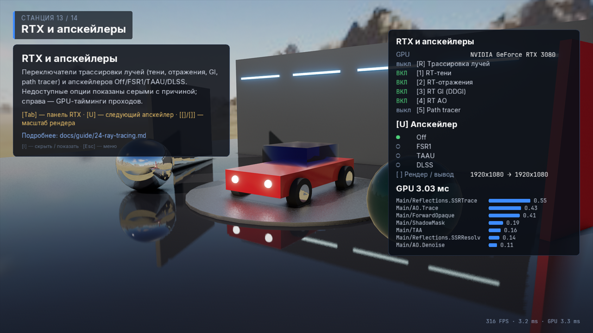 | 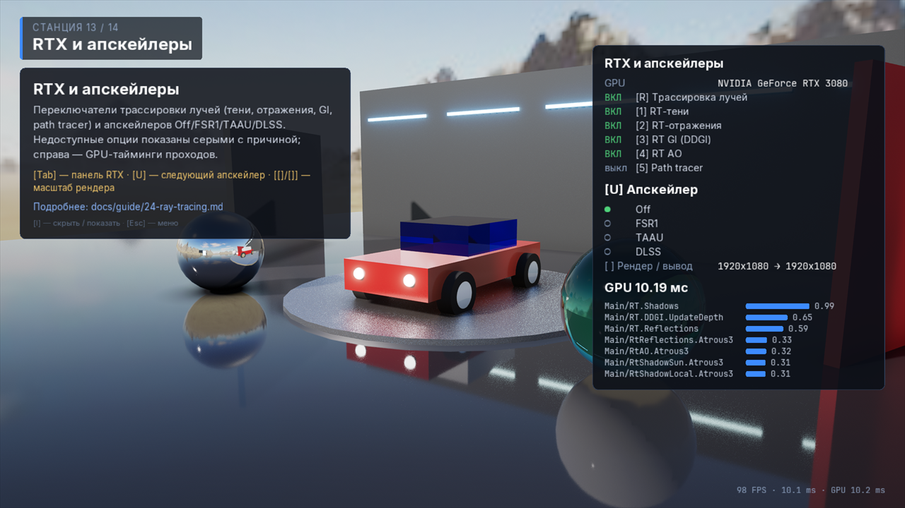 |

С трассировкой в хромовой сфере слева появляется отражение красной машины — в растровом кадре его нет. Синяя кабина машины и стеклянная сфера справа тоже выглядят иначе. В панели справа вместо растровых проходов (`Reflections.SSRTrace`, `AO.Trace`, `ShadowMask`) перечислены трассированные: `RT.Shadows`, `RT.DDGI.UpdateDepth`, `RT.Reflections` и проходы À-trous денойзера. Время GPU в этих двух кадрах — 3.03 и 10.19 мс (слои валидации включены). На диске под машиной в RT-кадре виден мелкий зернистый шум — это известный недостаток, см. «Типичные ошибки».

## Ключевые понятия

| Понятие | Что это |
| --- | --- |
| RT-железо | `DeviceCaps::rayTracingSupported()` = `VK_KHR_acceleration_structure` + `VK_KHR_ray_query`. Для path tracer'а в режиме 1 ещё нужен `VK_KHR_ray_tracing_pipeline` |
| Гейтинг | RT-эффект работает, только если включены `r.RayTracing`, `rayTracingSupported()` **и** cvar самого эффекта (`r.RayTracing.Shadows` и т. д.) |
| Эксклюзивная группа | RT-вариант и его растровый двойник состоят в одной группе (`Shadows`, `AO`, `Reflections`, `IndirectDiffuse`, `Translucency`). Побеждает фича с бóльшим приоритетом: у RT он 100, у растра 0 |
| `RtStatus` | Доступность каждого эффекта и человекочитаемая причина отказа — для подсказки у выключенной галочки |
| BLAS / TLAS | Ускоряющие структуры: BLAS на уникальный (submesh, LOD), один TLAS на кадр со всеми инстансами |
| SVGF-денойзер | Пространственно-временной фильтр: из 1 луча на пиксель делает гладкую картинку. Работает на любом GPU |
| DLSS Ray Reconstruction | Нейросеть NVIDIA, которая на RTX заменяет SVGF и апскейлер сразу: `r.Denoiser DLSSRR` или `Auto` (шаг 5) |
| DDGI | Окно зондов вокруг камеры, которое лучи обновляют каждый кадр |
| ReSTIR DI | Выбор источника света для теневого луча пропорционально его вкладу, с переиспользованием во времени и по соседям |

## Шаг 1. Требования к железу и сборке

| Что | Требование |
| --- | --- |
| GPU | NVIDIA RTX (Turing и новее), AMD RDNA2+, Intel Arc — любой GPU, у которого Vulkan-драйвер даёт `VK_KHR_acceleration_structure` и `VK_KHR_ray_query` |
| Path tracer, режим `Pipeline` | Дополнительно `VK_KHR_ray_tracing_pipeline` (режим `RayQuery` его не требует) |
| ОС | Windows или Linux с актуальным драйвером |
| macOS | Не поддерживается: MoltenVK транслирует Vulkan в Metal и не реализует Vulkan ray tracing. Шейдеры компилируются, CPU-логика и денойзер тестируются, сами лучи — нет |
| Сборка | Ничего особенного: RT-шейдеры компилируются в SPIR-V везде, а включаются по `DeviceCaps` во время работы |

Устройство включает RT-расширения само, если они есть. `DeviceDesc::enableRayTracing = false` позволяет *не* включать их, даже когда GPU их поддерживает. Это удобно, чтобы проверить растровые фолбэки на RTX-машине ([глава 17](17-rhi-vulkan.md)).

## Шаг 2. Галочка: редактор, проект, игрок, консоль

Галочка всегда одна и та же — cvar `r.RayTracing` (по умолчанию `false`). Где её можно поставить:

| Где | Как | Куда сохраняется |
| --- | --- | --- |
| Редактор: **Project Settings → Rendering → Hardware Ray Tracing** | Переключатель **Ray Tracing** + переключатели эффектов | `.oxproj` → `rendering.cvars` (значения проекта по умолчанию) |
| Редактор: **Preferences → Play → Game User Settings** | Переключатель **Ray Tracing** | `user://settings.json` → `graphics.rayTracing` (настройка игрока) |
| Игра: меню графики | `UserSettings::graphics.rayTracing` ([глава 04](04-cvars-quality.md)) | `user://settings.json` |
| Консоль / конфиг | `r.RayTracing 1` | — / `.ini` |

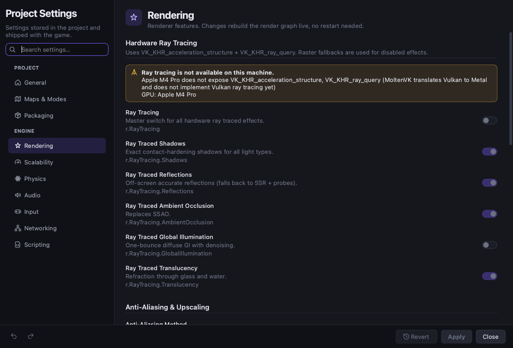

На машине без поддержки переключатель **Ray Tracing** неактивен. Сверху показан баннер с причиной и названием GPU, такая же подсказка всплывает над переключателем. Переключатели эффектов активны только при включённой галочке («Enable Ray Tracing first»). В строке состояния редактора рядом с названием GPU стоит «· RT», если трассировка доступна.

Свой экран настроек строится так же — по `rt::rayTracingStatus`:

```cpp
#include <oxwald/render/features/raytracing/raytracing.hpp>

const rt::RtStatus status = rt::rayTracingStatus(device.caps());
rtCheckbox.setEnabled(status.available);
rtCheckbox.setTooltip(status.reason);   // пусто, если доступно
for (const rt::RtEffectStatus& e : status.effects) {
    // e.name "Shadows", e.cvar "r.RayTracing.Shadows", e.available, e.reason
    addEffectToggle(e.name, e.cvar, e.available, e.reason);
}
```

Причины, которые увидит пользователь:

| Ситуация | `reason` |
| --- | --- |
| Mac (MoltenVK) | «Apple M4 Pro does not expose VK_KHR_acceleration_structure, VK_KHR_ray_query (MoltenVK translates Vulkan to Metal and does not implement Vulkan ray tracing yet)» |
| Старый GPU / драйвер | «<GPU> does not expose … (requires a ray tracing capable GPU and an up-to-date driver)» |
| Есть ray query, нет RT pipeline | только у эффекта «Path tracer (RT pipeline)»: «<GPU> does not expose VK_KHR_ray_tracing_pipeline (the ray query mode still works)» |

Эффекты в `RtStatus::effects` по порядку: Shadows, Reflections, Ambient occlusion, Global illumination, Translucency, Volumetrics, ReSTIR DI, Path tracer (ray query), Path tracer (RT pipeline).

Проверка «будут ли лучи в этом кадре»:

```cpp
RenderSettings s = RenderSettings::fromCVars();          // s.rayTracing = r.RayTracing
bool active = rt::rayTracingActive(s, device.caps());     // галочка && железо
```

Рендерер сам гасит `RenderSettings::rayTracing` на устройстве без поддержки. Поэтому `renderer->settings().rayTracing` показывает, что реально действует в кадре.

Полный пример: `samples/guide_examples/24-ray-tracing/rt_settings.cpp` (тесты `StatusAndReasonsForUi`, `GatingNeedsCheckboxAndHardware`).

## Шаг 3. Эффекты

У каждого эффекта свой cvar: выключенный эффект возвращает растровый вариант, остальные остаются трассированными.

| Эффект | CVar | Фича / заменяет | Как работает |
| --- | --- | --- | --- |
| Тени | `r.RayTracing.Shadows` | `ShadowsRT` / карты теней | `SamplesPerPixel` лучей на пиксель. Солнце — конус с угловым радиусом `LightComponent::sourceRadius` (градусы), локальные источники — сферы радиуса `sourceRadius` (м). Альфа-тест учитывается, сквозь `Transparent`/`Refractive` проходит цветной свет (`.Colored`). Явно трассируются до 4 локальных источников (`.MaxLocalLights`); с ReSTIR — все теневые |
| ReSTIR DI | `r.RayTracing.Shadows.ReSTIR` | — | Резервуары по всем теневым локальным источникам: 32 кандидата, временное переиспользование (M ≤ 20×), пространственное (4 соседа в 16 px). Видимость выбранного источника задаёт долю затенения для всех |
| Отражения | `r.RayTracing.Reflections` | `ReflectionsRT` / SSR + зонды | GGX (VNDF), 1 отскок с освещением в точке попадания (солнце + один случайный источник с теневыми лучами, emissive, DDGI). Вес плавно гаснет от 75 % до 100 % `MaxRoughness`; дальше работают зонды/IBL |
| AO | `r.RayTracing.AO` | `AmbientOcclusionRT` / SSAO, GTAO | Косинусные лучи длиной `AO.Radius` (1 м) |
| GI (DDGI) | `r.RayTracing.GI` | `GlobalIlluminationRT` / irradiance-зонды | Окно `ProbesXZ × ProbesY × ProbesXZ` с шагом `ProbeSpacing` (2 м) едет за камерой. `RaysPerProbe` лучей на зонд за кадр, гистерезис 0.97, бесконечные отскоки через прошлый кадр |
| Преломление | `r.RayTracing.Translucency` | `TranslucencyRT` / экранное преломление | Для `Refractive`-материалов: отражение по Френелю + путь преломления (Снеллиус, внутренние отскоки до `MaxBounces`, TIR, Бугер — Ламберт). Детерминированно, без шума и денойзера. `Transparent` остаются растровыми |
| Объёмы | `r.RayTracing.Volumetrics` | `VolumetricsRT` | Видимость на фроксел сетки тумана: солнце, доля локальных источников, небо. Работает, только если включён объёмный туман ([глава 22](22-volumetrics.md)) |
| Path tracer | `r.PathTracing` | `PathTracer` / весь кадр | Прогрессивное накопление (RGBA32F) до `MaxSamples`; сброс при любом изменении камеры, объектов, света, окружения или настроек. `r.PathTracing.Mode`: `RayQuery` (мегаядро) или `Pipeline` (SBT, только непрозрачные тени) |

```cpp
// Включить RTX, но AO оставить растровым (GTAO), а тени — с ReSTIR для сотни ламп.
CVarRegistry& cv = CVarRegistry::instance();
cv.set("r.RayTracing", "true");
cv.set("r.RayTracing.AO", "false");
cv.set("r.RayTracing.Shadows.ReSTIR", "true");
```

Что важно знать про отдельные эффекты:

- **Свет неба в лучах.** Луч GI, отражения или стекла, улетевший в небо, приносит яркость неба, умноженную на `EnvironmentComponent::ambientIntensity × r.IBL.Intensity` — так же, как растровый IBL, который эти эффекты заменяют. До версии 0.1.1 множитель не применялся, и при `ambientIntensity`, отличном от 1, включение `r.RayTracing` меняло общий уровень ambient. Если вы подбирали свет под старое поведение, проверьте сцену.
- **Разрешение DDGI.** Зонды стоят с шагом `r.RayTracing.GI.ProbeSpacing` (2 м). Детали мельче шага зонды не различают: узкая цветная полоса или тонкая перегородка в GI не отразится. Перенос цвета получается слабее эталонного: в тестовой сцене с красной стеной — около 2/3 от path tracer'а (0.052 против 0.078).
- **Режимы path tracer'а.** `r.PathTracing.Mode 0` (`RayQuery`) — одно compute-ядро, работает на любом RT-железе. `r.PathTracing.Mode 1` (`Pipeline`) — RT pipeline с таблицей шейдеров (SBT), нужен `VK_KHR_ray_tracing_pipeline`. Картинки двух режимов совпадают в пределах шума (тест сравнивает их на 512 spp), но режим 1 не даёт теней от полупрозрачных объектов. Режим 1 немного медленнее: 1.46 против 1.13 мс на сэмпл при 1080p на RTX 3080.

Картинки GPU-тестов (256×256, RTX 3080). Отражения: красная сфера висит выше кадра, в растре зеркальный пол пуст, с RT в нём видно её отражение.

| Растр | RT-отражения |
| --- | --- |
| 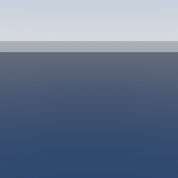 | 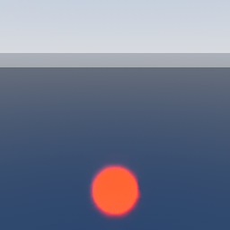 |

GI: красная стена, освещённая солнцем, и светлый пол. В растре пол нейтрально-серый, с DDGI он получает слабый красноватый оттенок, у эталона (path tracer) оттенок заметнее.

| Растр | DDGI | Path tracer (эталон) |
| --- | --- | --- |
| 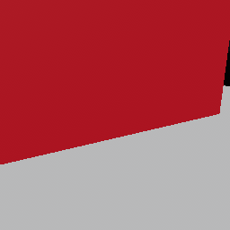 | 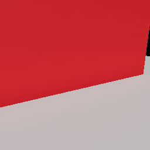 | 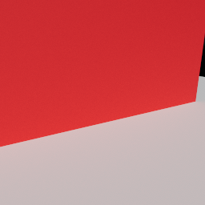 |

ReSTIR: 32 теневых источника над кубами, сферой и цилиндром. Слева кадр с `r.RayTracing.Shadows.ReSTIR` после денойзера, справа эталон path tracer'а (он зернистый: это накопление, а не фильтр). Глубина тени совпадает: 0.206 против 0.203.

| ReSTIR DI | Path tracer (эталон) |
| --- | --- |
| 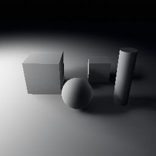 | 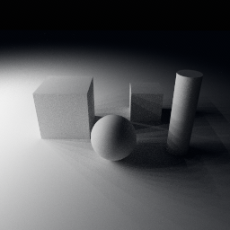 |

RT-тени от трёх пластин над полом: непрозрачная даёт сплошную тень, пластина с alpha-test в шахматную клетку — тень с дырками, зелёное стекло — зелёную тень.

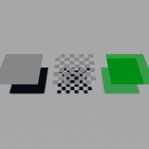

Сцена ускоряющих структур (`RayTracingScene`) строится, только если включён хотя бы один RT-эффект или path tracer.

- **BLAS** собирается на уникальный (submesh, LOD). По умолчанию берётся *самый грубый* LOD (`r.RayTracing.BLAS.LOD = -1`): теням, AO, GI и глянцевым отражениям упрощение не мешает. На Ultra используется LOD 0. Статические BLAS сжимаются (compaction). За кадр строится не больше `r.RayTracing.BLAS.BuildsPerFrame` (16) BLAS, крупные на экране — первыми. Неиспользуемые выгружаются.
- **TLAS** перестраивается раз в кадр. Если поменялись только трансформы, делается refit; при добавлении или удалении инстансов — rebuild.
- **Маски.** Материал определяет, какие лучи видят инстанс: непрозрачные и alpha-test видны теням, AO и GI; прозрачные — отражениям, преломлению и path tracer'у. `castShadows = false` в `MeshRendererComponent` делает объект невидимым для теневых лучей.
- **Скиннинг.** Анимированные меши трассируются в bind pose, пока зона мира/скиннинга не передаст позы через `RayTracingSceneApi::setDeformedGeometryProvider` ([глава 28](28-world-rendering.md)). С провайдером BLAS каждый кадр обновляется (refit) из результата compute-скиннинга, и тень следует за анимацией.

```cpp
#include <oxwald/render/features/raytracing/rt_api.hpp>

if (auto* api = rt::RayTracingSceneApi::find(renderer->features())) {
    bool traced = api->activeThisFrame();          // строился ли TLAS в этом кадре (можно спрашивать и после кадра)
    u32 instances = api->tlasInstanceCount();
}
```

Полный пример: `samples/guide_examples/24-ray-tracing/rt_settings.cpp` (тест `BlasLodMasksAndAccumulation`) и `rt_gpu.cpp` (тест `CheckboxSwapsEffectsOrIsInert`: на Mac проверяет, что галочка инертна, на RTX — что TLAS построен).

## Шаг 4. Качество: Scalability::RayTracing

Все параметры привязаны к группе масштабируемости `RayTracing`. Значения по уровням Low / Medium / High / Ultra:

| CVar | По умолчанию | Low / Medium / High / Ultra |
| --- | --- | --- |
| `r.RayTracing.Shadows` / `.Reflections` / `.AO` | on | on,on,on,on / off,on,on,on / off,on,on,on |
| `r.RayTracing.GI` / `.Translucency` / `.Volumetrics` | on | off,off,on,on / off,on,on,on / off,off,on,on |
| `r.RayTracing.Shadows.SamplesPerPixel` / `.MaxLocalLights` | 1 / 4 | 1,1,1,2 / 1,2,4,4 |
| `r.RayTracing.Shadows.ReSTIR` / `.Colored` | off / on | off,off,off,on / off,on,on,on |
| `r.RayTracing.Shadows.ResolutionScale` | 100 | 50,100,100,100 (50 — половина + апсемпл) |
| `r.RayTracing.Reflections.MaxRoughness` / `.SamplesPerPixel` / `.ResolutionScale` | 0.6 / 1 / 100 | 0.3,0.4,0.6,0.8 / 1,1,1,2 / 50,50,100,100 |
| `r.RayTracing.AO.SamplesPerPixel` / `.ResolutionScale` | 1 / 100 | 1,1,2,4 / 50,50,100,100 |
| `r.RayTracing.GI.RaysPerProbe` / `.ProbesXZ` / `.ProbesY` / `.ResolutionScale` | 128 / 24 / 8 / 100 | 64,96,128,256 / 12,16,24,32 / 6,8,8,12 / 50,50,100,100 |
| `r.RayTracing.Translucency.MaxBounces` | 4 | 2,3,4,6 |
| `r.RayTracing.Volumetrics.LocalSamples` / `.SkyRays` | 2 / 1 | 1,1,2,4 / 0,1,1,2 |
| `r.RayTracing.Denoiser.Iterations` | 4 | 3,4,4,5 |
| `r.RayTracing.BLAS.LOD` | −1 (самый грубый) | −1,−1,−1,0 |

Без уровней: `r.RayTracing.Shadows/Reflections/AO.Denoiser` (on), `r.RayTracing.AO.Radius` 1, `r.RayTracing.GI.ProbeSpacing` 2, `r.RayTracing.GI.Hysteresis` 0.97, `r.RayTracing.Denoiser.MaxHistory` 32, `r.RayTracing.BLAS.BuildsPerFrame` 16, `r.PathTracing` off, `r.PathTracing.Mode` RayQuery, `.MaxBounces` 8, `.SamplesPerFrame` 1, `.MaxSamples` 4096.

```cpp
scalability::setGroup(Scalability::RayTracing, QualityLevel::Low);
rt::RtSettings s = rt::RtSettings::fromCVars();   // снимок всех r.RayTracing.* / r.PathTracing.*
// s.reflections == false, s.gi == false, s.shadowResolutionScale == 50
std::vector<std::string> all = rt::rayTracingCVarNames();   // для группы в UI настроек
```

Автоопределение качества ставит группу `RayTracing` на Low, если поддержки нет ([глава 26](26-quality-settings.md)).

Полный пример: `samples/guide_examples/24-ray-tracing/rt_settings.cpp` (тест `SettingsAndScalability`).

## Шаг 5. Денойзер SVGF

Все шумные RT-эффекты (тени, отражения, AO, GI) пускают мало лучей (1 на пиксель) и чистят результат общим денойзером `rt::SvgfDenoiser` (Schied et al. 2017). Он написан на обычных compute-шейдерах и работает на любом GPU, в том числе на Mac.

1. **Временной шаг.** История репроецируется по `Velocity`. Каждый из 2×2 билинейных тапов проверяется по прошлой глубине и нормали; при разрыве история начинается заново. Вес нового кадра — `max(1/(len+1), 1/maxHistory)`.
2. **Дисперсия.** Считается из моментов яркости во времени, а пока история короче 4 кадров — пространственно, окном 7×7.
3. **À-trous.** `iterations` проходов ядра 5×5 с шагом 1, 2, 4, 8, 16. Края держатся по градиенту глубины, нормали и яркости (с учётом дисперсии). Выход первой итерации становится историей.
4. Для эффектов в половинном разрешении — joint-bilateral апсемпл по глубине и нормалям.

| `DenoiserSettings` | По умолчанию | Смысл |
| --- | --- | --- |
| `enabled` | true | false — вход проходит насквозь (только конверсия формата) |
| `iterations` | 4 | Проходы À-trous (0..5); cvar `r.RayTracing.Denoiser.Iterations` |
| `maxHistory` | 32 | Минимальный вес нового кадра 1/32; cvar `r.RayTracing.Denoiser.MaxHistory` |
| `phiColor`, `phiNormal`, `phiDepth` | 4, 128, 1 | Жёсткость краёв по яркости, нормали, глубине |
| `lumaWeights` | (0.2126, 0.7152, 0.0722, 0) | Какой сигнал направляет фильтр: цвет, скалярный AO, 4 канала теней |
| `output` | `RGBA16F` | `RGBA16F`, `RGBA8`, `R8` |
| `temporal` | true | false — только пространственный фильтр |
| `clampHistory` | false | История ограничивается диапазоном текущей окрестности 5×5. Для сигналов видимости (тени): без этого за движущейся тенью тянется шлейф. Для шумной яркости (глянцевые отражения) не годится — теряется энергия |

Измерено на M4 Pro: шумный AO с 1 spp против эталона в 256 spp даёт RMSE 0.188 до денойзера и 0.026 после. После резкого сдвига камеры «призраков» нет. Цена на 1080p RGBA16F: временной шаг 0.56 мс, дисперсия 0.29 мс, À-trous 1.2 мс за итерацию — около 5.7 мс при 4 итерациях; в половинном разрешении примерно вчетверо меньше. Эффекты с короткой историей: отражения используют `maxHistory` 12, иначе зеркала смазываются при движении. RT-тени (солнце, локальные источники, ReSTIR) включают `clampHistory`: тень объекта, который сдвинулся, исчезает со старого места за считаные кадры, а не за 32 (тест смотрит через 8 кадров после остановки). AO и отражения историю не ограничивают, поэтому под движущимися объектами они запаздывают.

На RTX 3080 денойзер одного сигнала стоит около 1.5 мс при 1080p и 5.4–5.8 мс при 4K. Сигналов четыре (тени солнца, локальные тени, AO, отражения), и вместе это бóльшая часть цены RT-режима — см. шаг 6.

Свою фичу с шумным экранным сигналом можно чистить тем же денойзером: `SvgfDenoiser::denoise(ctx, "MyEffect", inputs, settings)`. Имя задаёт историю в виде, поэтому у каждого эффекта оно своё. Как писать фичи — в [главе 18](18-rendering-overview.md).

### DLSS Ray Reconstruction вместо SVGF: `r.Denoiser`

На NVIDIA RTX шумные RT-эффекты может чистить не SVGF, а нейросеть NVIDIA DLSS Ray Reconstruction (RR). Она получает весь шумный кадр сразу и одним проходом убирает шум и масштабирует картинку до выходного разрешения, то есть заменяет и SVGF, и апскейлер (DLSS, TAAU, TAA).

| `r.Denoiser` | Что происходит |
| --- | --- |
| `SVGF` | По умолчанию в коде: SVGF у каждого эффекта + выбранный апскейлер |
| `DLSSRR` (`RR`) | Ray Reconstruction, если она доступна; иначе SVGF |
| `Auto` | То же, что `DLSSRR`. Его ставят автоопределение качества, меню настроек игры и редактора |
| `Neural` | Экспериментальный нейроденойзер, см. [главу 36](36-neural-rendering.md) |

RR включается, только когда одновременно выполнены условия: включена трассировка лучей, path tracer выключен, GPU — NVIDIA RTX, рядом с исполняемым файлом лежит `nvngx_dlssd.dll` (сборка кладёт её сама), драйвер достаточно свежий. Иначе эффекты остаются на SVGF, а апскейлер — тот, что выбран. Почему RR недоступна, скажет `rayReconstructionAvailability(device).reason`.

Где выбрать: редактор — **Preferences → Play → Game User Settings → Ray Tracing Denoiser** (`user://settings.json` → `graphics.denoiser`), игра — строка «RT denoiser» в меню графики (`UserSettings::graphics.denoiser`), консоль — `r.Denoiser DLSSRR`. Разрешение рендера задаёт `r.Upscaler.Quality` (размеры как у DLSS, [глава 25](25-upscalers-postprocess.md)); при `r.Upscaler Off` RR работает как DLAA. Свой экран настроек:

```cpp
#include <oxwald/render/features/postprocess/postprocess.hpp>

const RayReconstructionAvailability rr = rayReconstructionAvailability(&device);
denoiserCombo.setItemEnabled("DLSS Ray Reconstruction", rr.available);
denoiserCombo.setItemTooltip("DLSS Ray Reconstruction", rr.reason); // пусто, если доступно
```

Что меняется в кадре: тени, AO и отражения по-прежнему пускают 1 луч на пиксель, но их SVGF-проходы (временной, дисперсия, À-trous) не выполняются. Вместо них проход `RT.RRGuides` готовит для сети цвет материала (диффузное и зеркальное альбедо), а `DLSSRR` получает шумный кадр, глубину, векторы движения, нормали с шероховатостью, расстояние до попадания отражённых лучей и матрицы камеры. Переключать `r.Denoiser` можно на ходу: когда RR выключается, её фича NGX освобождается сразу.

**Качество.** Тест `RayReconstructionTest.ImageQualityAndStabilityVersusSvgfPlusDlss` (RTX 3080, 640×360, шероховатая золотая сфера, глянцевая металлическая плита):

| | Против path tracer'а | Против сошедшегося гибридного кадра | Мерцание |
| --- | --- | --- | --- |
| SVGF + DLSS Quality | 25,81 дБ | 34,54 дБ | 0,037 |
| RR Quality | 25,32 дБ | 37,82 дБ | 0,089 |
| SVGF + DLAA | 25,67 дБ | 37,12 дБ | 0,031 |
| RR DLAA | 25,32 дБ | 38,19 дБ | 0,045 |

«Сошедшийся гибридный кадр» — то же освещение без денойзера, с 32 лучами на пиксель и долгим накоплением. Против него RR чище SVGF на 1–3 дБ и не оставляет «искр» на золоте. Против path tracer'а RR на 0,35–0,5 дБ ниже. Причина не в RR: гибридное освещение одинаково для обоих денойзеров и не знает второго отскока внутри отражений (нижние половины сфер в плите темнее, чем у path tracer'а). Остаточные искры SVGF в этих местах случайно добавляют часть недостающей энергии, а RR их честно убирает. Входы RR (альбедо, шероховатость, расстояние до попадания, матрицы) проверены отдельными замерами.

**Цена на RTX 3080** (сцена из 240 объектов, валидация выключена, мс кадра GPU):

| Выход | Режим | SVGF + DLSS | RR |
| --- | --- | --- | --- |
| 1920×1080 | Quality | 5,95 | 7,18 |
| 1920×1080 | Performance | 5,06 | 4,70 |
| 1920×1080 | DLAA | 9,97 | 13,74 |
| 3840×2160 | Quality | 17,53 | 24,47 |
| 3840×2160 | Performance | 14,34 | 13,52 |
| 3840×2160 | DLAA | 35,17 | 49,02 |

RR экономит проходы SVGF (2,5 мс при рендере 720p, 9,2 мс при 1440p), но сама сеть на RTX 3080 дороже их везде, кроме режима Performance. Так что на этой карте RR — это опция качества, а не ускорение. Ещё одна цена — видеопамять: при первом кадре с RR драйвер выделяет около 180–510 МБ (сеть и рабочая память NGX), и они остаются занятыми до уничтожения устройства, даже если RR выключить. Повторные переключения память не наращивают.

## Шаг 6. Что проверено и сколько это стоит

### Проверено на RTX 3080

Трассировка лучей исполнена и проверена на одной машине: Windows 11, NVIDIA GeForce RTX 3080 10 ГБ, драйвер 617.42, слои валидации 1.4.341 (октябрь 2026). До этого код только компилировался и тестировался на Mac, где лучей нет.

- **GPU-тесты.** `ox_render_gpu_tests --gtest_filter=RayTracingTest.*`: 20 тестов проходят, один пропускается по делу (тест «галочка инертна без поддержки» на машине с поддержкой). Тесты покрывают: тени солнца против карт теней; локальные тени без ReSTIR; тени от alpha-test и цветного стекла; ReSTIR с 32 источниками против path tracer'а; RTAO; отражение объекта вне кадра; перенос цвета DDGI против path tracer'а; преломление; RT-видимость тумана; сходимость и сброс path tracer'а; режим 1 path tracer'а против режима 0; переключение галочки на ходу без утечек; TLAS на 300 кадрах с движущимися объектами при неизменной VRAM. Плюс `SkinningTest.RayTracedShadowFollowsAnimation`: тень скиннингового меша следует за анимацией.
- **Валидация.** Обычные слои валидации и sync validation на этих тестах ошибок не дают.
- **Демо-проект.** Станции 01, 02, 03, 04, 08 и 13 отрисованы в 1920×1080 с `r.RayTracing` и без него: ошибок валидации нет, RT-тени совпадают с растровыми по положению и направлению, зеркальный пол и хромовые сферы отражают объекты вне кадра.
- **Весь набор.** Полный `ctest` на этой машине: 1249 тестов, ни один не падает, 3 пропущены по делу.

Станция 03 «Отражения и GI», растр и RTX:

| `r.RayTracing` выключен | `r.RayTracing` включён |
| --- | --- |
| 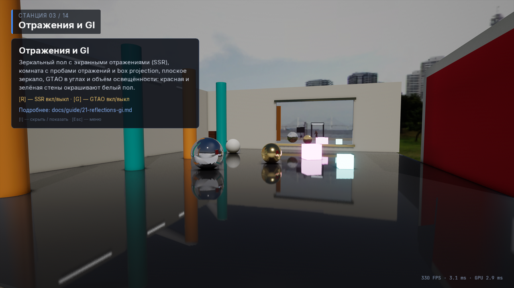 | 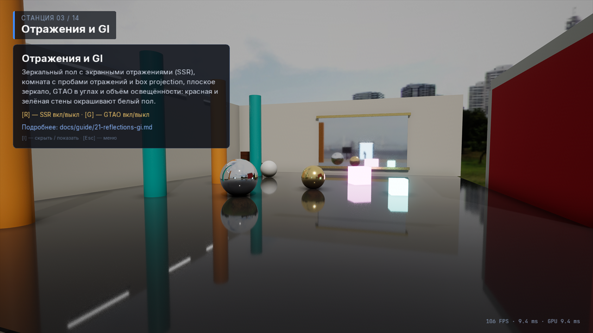 |

В растровом кадре зеркальный пол отражает только то, что есть на экране (SSR), и ближняя к камере часть пола остаётся тёмной. С трассировкой в этой части пола видно отражение неба и стен. Вокруг светящихся кубов и в зеркале на дальней стене в RT-кадре виден зернистый шум. Время GPU в этих кадрах — 2.9 и 9.4 мс (слои валидации включены).

**Не проверено:** переключение галочки вручную в окне плеера и редактора (проверено только автотестом), меню настроек в игре, захват кадра в Nsight Graphics (число инстансов TLAS, степень сжатия BLAS), Linux, видеокарты других производителей. Пункты чек-листа ниже, которые требуют смотреть на движение глазами (смазывание зеркал, скроллинг окна DDGI, протечки света), тоже не пройдены.

### Проверено на Mac (MoltenVK, без RT)

`ctest -L render`:

- все RT-шейдеры и их варианты дефайнов компилируются в оптимизированный SPIR-V: compute с ray query и все стадии RT pipeline, push-блоки ≤ 128 байт;
- CPU-логика: маски TLAS, смещения SBT, упаковка трансформов, выбор refit или rebuild; планировщик BLAS (бюджет, приоритеты, жизненный цикл compaction, refit/rebuild деформируемых, выгрузка) против асинхронного мока; политика LOD; сбросы накопления; адресация, скроллинг и атлас DDGI; таблицы масштабируемости; причины недоступности; гейтинг эксклюзивных групп с RT-железом и без;
- GPU на обычных compute-шейдерах: денойзер (цифры выше), смешивание и применение DDGI на синтетических лучах, резервуары ReSTIR выбирают источники пропорционально вкладу (0.784 для пары 4:1). И главное: `r.RayTracing` на устройстве без поддержки инертен — те же проходы, та же картинка, ни одного RT-пайплайна.

Тесты, которым нужны лучи, на Mac делают `GTEST_SKIP`.

### Сколько стоит RT-режим

Замер на RTX 3080 без слоёв валидации, сборка RelWithDebInfo, настройки RT по умолчанию, без апскейлера. Сцена теста: 240 объектов, зеркальный участок пола, 4 стеклянные сферы, 8 теневых точечных источников, солнце, туман.

| Конфигурация | 1080p: кадр GPU, мс | 1080p: из них RT, мс | 4K: кадр GPU, мс | 4K: из них RT, мс |
| --- | --- | --- | --- | --- |
| Растр | 1.5 | — | 3.5 | — |
| `r.RayTracing` (все эффекты по умолчанию) | 9.8 | 9.2 | 32.9 | 31.2 |
| + `r.RayTracing.Shadows.ReSTIR` | 9.7 | 9.0 | 33.7 | 32.0 |
| `r.PathTracing`, режим 0 | 1.7 | 1.1 | 5.6 | 4.1 |
| `r.PathTracing`, режим 1 | 2.2 | 1.6 | 7.0 | 5.5 |

Под path tracer'ом гибридные эффекты (тени, AO, GI, отражения, видимость тумана, преломление и их денойзеры) не
работают и не выделяют память: картинку кадра целиком заменяет path tracer. До 2026-10-15 они продолжали считаться
впустую, и строки path tracer'а стоили 10.3 / 36.1 мс (режим 0, 1080p / 4K).

Куда уходит время в строке «все эффекты по умолчанию»:

| Эффект | 1080p, мс | 4K, мс |
| --- | --- | --- |
| Тени: лучи + денойзер двух сигналов (солнце, локальные) | 1.1 + 3.0 | 4.5 + 11.5 |
| AO: лучи + денойзер | 0.1 + 1.5 | 0.4 + 5.7 |
| Отражения: лучи + денойзер | 0.2 + 1.4 | 0.8 + 5.4 |
| GI (DDGI): все проходы | 1.4 | 2.1 |
| Преломление | 0.2 | 0.8 |
| RT-видимость тумана | 0.2 | 0.2 |
| Обновление TLAS | 0.01 | 0.01 |

Выводы для настройки:

- Основная цена — денойзер, а не лучи: 5.9 из 9.2 мс при 1080p и 22.5 из 31.2 мс при 4K. Он работает в разрешении рендера, поэтому в 4K RT-режим без апскейлера в этой сцене не укладывается в 60 кадров/с на этой карте. Рендерите в меньшем разрешении с DLSS или TAAU ([глава 25](25-upscalers-postprocess.md)) либо ставьте `ResolutionScale` 50 у эффектов (так делают уровни Low и Medium группы `RayTracing` для отражений, AO и GI).
- Обновление зондов DDGI и видимость тумана от разрешения не зависят.
- ReSTIR добавляет около 1 мс при 1080p и 3.8 мс при 4K, но сам проход теней дешевеет, так что кадр стоит примерно столько же.
- Path tracer стоит 1.1–1.5 мс на сэмпл при 1080p; остальное время в его строках — гибридные RT-проходы, которые под ним пока продолжают выполняться.
- Видеопамять в этой сцене: включение RT добавляет около 0.6 ГБ при 1080p и около 1.6 ГБ при 4K (810 → 1398 МБ и 1959 → 3555 МБ по счётчику устройства).

Повторить замер: `OX_RT_PERF=1 OX_VULKAN_VALIDATION=0 ox_render_gpu_tests --gtest_filter=RayTracingTest.PerfReportRayTracing` (`OX_RT_PERF=<ширина>x<высота>` — одно своё разрешение). Таблица по проходам — в [`docs/dev/perf.md`](../dev/perf.md).

### Чек-лист на машине с NVIDIA RTX

Этот список — для новой машины или нового драйвера. В скобках указано, что из пункта пройдено на RTX 3080: **тест** — проверяет автотест, **картинка** — проверено глазами по отрисованному кадру, **не сделано**.

1. `ox_render_gpu_tests --gtest_filter=RayTracingTest.*`: пропущен только `RayTracingCheckboxIsInertWithoutSupport`, нет ошибок validation. Посмотрите `<temp>/oxwald_render_out/rt_shadows.png` и остальные `rt_*.png`. (Тест, картинка.)
2. Плеер или редактор: несколько раз переключите `r.RayTracing` на ходу. Не должно быть рывков, кроме сборки BLAS; VRAM стабильна (`r.GpuTimings`, оверлей статистики); видны все RT-проходы (`RT.BuildAS`, `RT.Shadows`, …). (Тест `RuntimeToggleRebuildsGraphWithoutLeaks`; список проходов — картинка станции 13; переключение вручную в окне не сделано.)
3. Тени: contact hardening при `sourceRadius` солнца 0.5° и 3°; в тенях листвы с alpha-test есть дыры; стекло даёт тонированную тень; с `r.RayTracing.Shadows.ReSTIR` и 100+ теневыми точечными источниками тени стабильны. (Тест: дыры alpha-test, цветная тень стекла, ReSTIR с 32 источниками. Не сделано: сравнение 0.5° и 3°, 100+ источников.)
4. Отражения: зеркальный пол показывает объекты, которых нет в кадре, — те, что выше или дальше его границ (плоский пол не может отразить то, что позади камеры; это может только выпуклое зеркало, например хромовая сфера); при roughness 0 → 1 отражение плавно переходит в зонды; на солнце нет светлячков; при движении камеры смазывание на зеркалах приемлемое. (Тест `RtReflectionsSeeOffscreenObjects`; картинки станций 03 и 13. Не сделано: развёртка по roughness, движение камеры.)
5. AO/GI: затемнение в контактах без экранных ореолов; красная стена «красит» белый пол; при проходе по уровню окно DDGI скроллится без скачков (новые слои сходятся примерно за 1 с); свет не протекает сквозь тонкие стены. (Тест: затемнение AO, перенос цвета против path tracer'а. Не сделано: скроллинг окна на ходу, протечки.)
6. Стеклянная сфера: преломление переворачивает фон, у краёв кольцо полного внутреннего отражения, цветное поглощение по `absorptionDistance`, отражения объектов за кадром. (Тест `RtRefractionThroughGlass` сравнивает кадр целиком; картинка. По отдельности подпункты не проверялись.)
7. Объёмный туман с RT: лучи света от окклюдеров за кадром, световые столбы от локальных источников. (Тест `RtVolumetricFogVisibility`: крыша затеняет туман так же, как карты теней; картинка станции 04. Окклюдеры за кадром и локальные источники отдельно не проверялись.)
8. `r.PathTracing 1` (оба `r.PathTracing.Mode`, 0 и 1): картинка сходится без шума примерно за 1000 spp, сбрасывается при любом движении камеры или объекта, в целом совпадает с растровой (у растра нет GI и мягких теней). (Тесты `PathTracerConvergesAndResetsOnCameraChange` и `PathTracerPipelineMatchesRayQuery`; вручную в окне не сделано.)
9. Скиннинговый персонаж с `DeformedGeometryProvider`: тень следует за анимацией (refit), «застывшей» bind pose нет. (Тест `SkinningTest.RayTracedShadowFollowsAnimation`; картинка станции 08.)
10. Захват в Nsight Graphics: число инстансов TLAS равно числу видимых инстансов, сжатые BLAS занимают около 50 % от несжатых. (Не сделано. Равенство числа инстансов TLAS числу живых инстансов проверяют автотесты; степень сжатия не измерялась.)

Плюс быстрые проверки из этой главы: `ctest -L guide -R GuideRayTracing` — на RTX тест `CheckboxSwapsEffectsOrIsInert` идёт по ветке «TLAS построен», а `StatusOfThisDevice` печатает статус каждого эффекта.

## Типичные ошибки и подводные камни

- **«Включил RTX, ничего не изменилось».** Сначала проверьте `rt::rayTracingStatus(caps).reason`. На Mac и старых GPU галочка инертна по замыслу. На RTX проверьте cvar самого эффекта и `r.Feature.ShadowsRT` и т. п.
- **`rendering.rayTracingIfSupported` в `.oxproj` ничего не включает.** Поле читается, но рантайм его пока не применяет. Значение проекта по умолчанию задавайте через `"rendering": {"cvars": {"r.RayTracing": "true"}}`.
- **Переключатели RT AO и RT GI в Project Settings не действуют.** Редактор пишет cvar'ы `r.RayTracing.AmbientOcclusion` и `r.RayTracing.GlobalIllumination`, а рендерер читает `r.RayTracing.AO` и `r.RayTracing.GI`. До исправления включайте эти эффекты через консоль или `rendering.cvars`.
- **Тени пропали у части ламп.** Без ReSTIR трассируются только 4 локальных источника на вид (`r.RayTracing.Shadows.MaxLocalLights`), остальные остаются без теней. Включите `r.RayTracing.Shadows.ReSTIR`.
- **Прозрачные объекты освещены «без теней».** Потребители не в экранном пространстве (прозрачность, частицы) в RT-режиме получают солнце и локальные источники без затенения.
- **Отражения отличаются от модели.** Для BLAS берётся грубый LOD. Если в зеркальном полу видно упрощение, поставьте `r.RayTracing.BLAS.LOD 0`.
- **Персонаж отбрасывает тень в T-позе.** Не подключён `setDeformedGeometryProvider` — меш трассируется в bind pose.
- **`r.Denoiser DLSSRR`, а в кадре всё равно SVGF.** RR недоступна (не RTX, нет `nvngx_dlssd.dll`, старый драйвер, устройство создано без `appendUpscalerVulkanExtensions`) или включён path tracer. Причину даёт `rayReconstructionAvailability(device).reason`; проход `DLSSRR` в статистике кадра означает, что RR работает.
- **Шум или «плывущие» тени.** Мало истории (резкие движения) или выключен денойзер (`r.RayTracing.*.Denoiser`). Добавьте `SamplesPerPixel` или итераций денойзера, но учтите цену.
- **Path tracer «не сходится».** Накопление сбрасывается от любого изменения: анимированные объекты, ветер, время суток. Для эталонного кадра остановите сцену.
- **Path tracer и производительность.** Растровые и гибридные RT-проходы (тени, DDGI, AO, отражения с денойзерами) под path tracer'ом продолжают выполняться: его картинка заменяет кадр перед постобработкой. Это инструмент сверки, а не игровой режим.
- **Path tracer в режиме 1 не даёт теней от стекла.** В режиме `Pipeline` полупрозрачные объекты тени не отбрасывают. Для сверки сцен со стеклом используйте режим 0.
- **GI только вокруг камеры.** DDGI — одно окно зондов, которое едет за камерой. Дальше окна работает растровый фолбэк, переносов и классификации зондов нет.
- **GI не видит мелких деталей.** Всё, что мельче шага зондов (2 м по умолчанию), в GI не попадает, а перенос цвета слабее, чем у path tracer'а.
- **Ambient изменился после обновления до 0.1.1.** Свет неба в лучах GI и отражений теперь умножается на `ambientIntensity × r.IBL.Intensity`, как растровый IBL. Раньше при `ambientIntensity ≠ 1` RT-режим был светлее или темнее растрового.
- **Зернистый шум на шероховатом металле и вокруг ярких emissive-объектов.** С RT-отражениями на таких поверхностях остаётся мелкая «крупа» (видна на станциях 03 и 13). Причина пока не разобрана.
- **AO и отражения запаздывают под движущимися объектами.** Денойзер этих сигналов не сбрасывает историю, когда окклюдер сдвинулся; у теней это исправлено (`clampHistory`).
- **Персонаж и первые кадры.** Первый BLAS скиннингового меша может построиться до compute-скиннинга этого кадра; поза исправляется refit'ом в следующих кадрах.
- **Матовое стекло в RT.** RT-преломление детерминированное и гладкое; матовое (rough) стекло в RT-режиме выглядит гладким.

## API

| Заголовок | Содержимое |
| --- | --- |
| [`raytracing.hpp`](../../engine/render/include/oxwald/render/features/raytracing/raytracing.hpp) | `RtSettings` (+`fromCVars`), `rayTracingActive`, `rayTracedRefractionActive`, `RtStatus`/`RtEffectStatus`, `rayTracingStatus`, `rayTracingCVarNames`, `registerRayTracingCVars`, `registerRayTracingFeatures`, группы `kGroup*`, `kRtPriority` |
| [`rt_api.hpp`](../../engine/render/include/oxwald/render/features/raytracing/rt_api.hpp) | `RayTracingSceneApi`: `find`, `setDeformedGeometryProvider`, `activeThisFrame`, `sceneHeaderAddress`, `tlasInstanceCount`, `blasStats` |
| [`rt_scene.hpp`](../../engine/render/include/oxwald/render/features/raytracing/rt_scene.hpp) | Маски `kMask*`, `instanceMask`, `selectBlasLod`, `TlasInstanceTable`, `BlasScheduler`, `IBlasBackend`, `DeformedGeometry`, `AccumulationTracker` |
| [`denoiser.hpp`](../../engine/render/include/oxwald/render/features/raytracing/denoiser.hpp) | `SvgfDenoiser`, `DenoiserSettings`, `DenoiserInputs/Outputs`, `DenoiseOutput` |
| [`ddgi.hpp`](../../engine/render/include/oxwald/render/features/raytracing/ddgi.hpp) | Раскладка DDGI: `DdgiVolumeDesc`, адресация зондов, атлас, направления лучей |
| [`device_caps.hpp`](../../engine/rhi/include/oxwald/rhi/device_caps.hpp) | `DeviceCaps::rayTracingSupported`, `rayTracingPipeline`, `whyRayTracingUnavailable` |

Шейдеры: `engine/shaders/render/raytracing/`. Подробности для разработчиков модуля: [`docs/dev/modules/render.md`](../dev/modules/render.md), раздел 11.

## Что дальше

- [17. RHI и Vulkan](17-rhi-vulkan.md) — `DeviceCaps`, BLAS/TLAS на уровне RHI.
- [20. Свет и тени](20-lighting-shadows.md) — растровые тени, которые заменяет RTX.
- [21. Отражения и GI](21-reflections-gi.md) — растровые SSR, зонды, GTAO.
- [25. Апскейлеры и постобработка](25-upscalers-postprocess.md) — DLSS на тех же RTX-картах.
- [26. Настройки качества](26-quality-settings.md) — группа `RayTracing` и автоопределение.
- [Оглавление](README.md).
