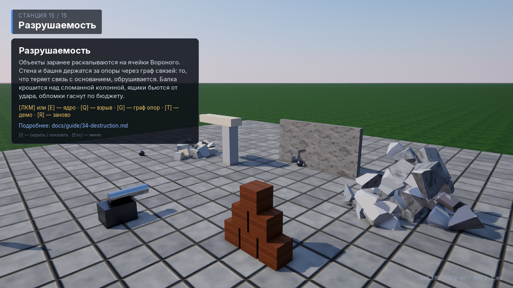

# 34. Разрушаемость

> Фрактура — модуль `physics` ([`fracture.hpp`](../../engine/physics/include/oxwald/physics/fracture.hpp), чистый CPU-код
> без Jolt). Компоненты и рантайм — модуль `gameplay`
> ([`destruction.hpp`](../../engine/gameplay/include/oxwald/gameplay/destruction.hpp)). Куски рисуются обычным путём
> мешей рендера. Живой пример — станция 15 тестового проекта ([33. OxwaldShowcase](33-showcase.md)).

## Зачем

Стена, в которой ядро пробивает дыру, колонна, после которой рушится балка, ящик, разлетающийся от удара. Для этого
нужно четыре вещи:

1. **Расколоть** объект на куски заранее. Считать это в момент удара слишком дорого, а заранее посчитанное
   разбиение ещё и одинаково на всех машинах.
2. **Подменить** целый объект кусками в момент разрушения. Куски должны унаследовать его скорость и получить импульс
   удара.
3. **Держать конструкцию.** Кусок, у которого не осталось пути до опоры, должен падать. Целые куски стены висеть в
   воздухе не должны.
4. **Убирать мусор.** Обломки засыпают, растворяются и укладываются в бюджет, иначе через минуту боя физика
   захлебнётся.

## Ключевые понятия

| Понятие | Что это |
| --- | --- |
| `physics::voronoiFracture` | Разбиение замкнутого меша на ячейки Вороного: семена внутри меша, отсечение плоскостями-биссектрисами, крышки разрезов с отдельным материалом и UV. Детерминировано по `seed`. |
| `FractureResult` | Куски (`FractureChunk`: геометрия относительно центра масс, точки выпуклой оболочки, объём, границы) и связи `FractureLink` между соседями с площадью общей грани. |
| `DestructibleComponent` (`Destructible`) | Компонент разрушаемого объекта: число кусков, seed, здоровье, пороги урона и импульса, обломки, структурный режим. Редактируется в инспекторе как любой компонент. |
| `DestructionChunkComponent` (`DestructionChunk`) | Метка куска во время игры: владелец, индекс, «заморожен», «опорный». В сцену не сохраняется. |
| `DestructionRuntime` | Сервис: готовит фрактуру при входе в play mode, принимает урон и контакты, ломает, держит граф опор, считает бюджет обломков. |
| `DestructionEvent` | Событие `Fractured` / `ChunksReleased` / `Collapsed` для геймплея и звука: `Signal`, `EventBus`, Lua `onEvent`. |
| Структурный объект | `structural = true`: при разрушении куски остаются **замороженными** (статичными), отпадают только куски у точки удара и те, что потеряли связь с опорами. |
| Опоры (`anchor`) | `Bottom` — куски у нижней грани объекта; `Static` — куски, касающиеся статических тел (земля, колонны); `None` — опор нет. |

## Шаг 1. Фрактура меша

```cpp
#include <oxwald/physics/fracture.hpp>
using namespace ox::physics;

FractureMesh box = makeBoxFractureMesh({1.0f, 0.5f, 0.75f});   // или свой замкнутый меш, makeConvexHullFractureMesh(points)
FractureSettings s;
s.chunkCount = 16;
s.seed = 42;                  // тот же меш + настройки + seed -> побитово тот же результат
s.interiorUvScale = 1.0f;     // UV крышек разреза: единиц текстуры на метр
FractureResult r = voronoiFracture(box, s);

for (const FractureChunk& c : r.chunks) {
    // c.positions / normals / uvs / indices — относительно c.centroid (центр масс куска)
    // индексы [0, c.interiorIndexStart) — внешняя поверхность, дальше — грани разреза
    // c.hullPoints — точки для ShapeDesc::convexHull, c.volume — объём, c.boundsMin/Max — в координатах меша
}
for (const FractureLink& l : r.links) { /* l.a, l.b — соседи, l.area — площадь общей грани */ }

std::vector<u8> bytes = serializeFracture(r);         // кэш: "OXFR", версия, CRC
std::optional<FractureResult> back = deserializeFracture(bytes);
```

Как это устроено:

- **Семена** выбираются внутри меша собственным генератором splitmix64 (не `std::uniform_*`: те по стандарту дают
  разные числа в разных реализациях). Точка внутри или нет, решает обобщённое число обхода (winding number).
  `minSeedSpacing` отбрасывает слишком близкие семена, чтобы не получались щепки. `focus` + `focusRadius` +
  `focusFraction` собирают часть семян у заданной точки: мелкие куски у места удара, крупные вдали.
- **Ячейка** семени — это меш, по очереди отсечённый биссектрисами ко всем другим семенам. Ближние плоскости
  отсекают первыми, а дальние, которые до ячейки уже не дотягиваются, пропускаются. Каждый разрез закрывается
  крышкой: ребра границы собираются в контуры и триангулируются ear clipping'ом. Точка пересечения ребра считается
  в каноническом порядке вершин, поэтому оба треугольника ребра получают её побитово одинаковой, и меш куска
  остаётся замкнутым.
- **Тонкие объекты.** Если наименьший размер меньше `planarRatio` (0.6) × средний (стены, плиты, балки), все семена
  кладутся в среднюю плоскость. Куски получаются призмами сквозь толщину: выбитый кусок вылетает из стены, а не
  застревает между соседями на скошенных гранях.
- **Проверки** (тесты `Fracture.*`): куски замкнуты, их объёмы в сумме дают объём исходника (допуск 0.1 %),
  результат детерминирован, куски не выходят за границы исходника, оболочки корректны для Jolt.
  32 куска коробки считаются примерно за 60 мс.

Вход должен быть **замкнутым** мешем, а вершины соседних треугольников должны совпадать точно (welded). Невыпуклые
меши режутся честно, но коллизия каждого куска — выпуклая оболочка куска. Сквозные отверстия (тор, кольцо) не
поддерживаются: крышка с дыркой не строится.

## Шаг 2. Компонент `Destructible`

```cpp
#include <oxwald/gameplay/gameplay.hpp>
using namespace ox::gameplay;

// Обычный объект: меш + коллайдер (+ RigidBody для динамики), плюс Destructible.
Entity crate = world.create("Crate");
crate.setPosition({0, 0.45f, 0});
crate.setScale(glm::vec3(0.9f));
crate.add<MeshRendererComponent>() = {.mesh = render::primitiveUuid(render::Primitive::Cube), .materials = {crateMat}};
crate.add<RigidBodyComponent>().mass = 25.0f;
crate.add<ColliderComponent>().halfExtents = glm::vec3(0.5f);
auto& d = crate.add<DestructibleComponent>();
d.chunkCount = 8;
d.seed = 7;
d.interiorMaterial = woodMat;    // материал граней разреза (пусто = внешний)
d.impulseThreshold = 120.0f;     // удар сильнее 120 Н·с ломает сразу
d.debrisLifetime = 6.0f;         // через 6 с лежащие обломки растворяются
d.maxActiveDebris = 4;           // больше 4 движущихся кусков этого ящика не бывает
```

Источник фрактуры — коллайдер сущности: `Box`, `ConvexHull` (точки или меш), `Mesh` (через `IMeshColliderProvider`),
`Sphere`, `Capsule` и `Cylinder` (как выпуклые оболочки), с учётом `scale`/`offset` коллайдера и мирового масштаба
сущности. `sourceMesh` позволяет взять для фрактуры отдельный замкнутый меш. Куски берут материалы `MeshRenderer`:
слот 0 — внешняя поверхность, слот 1 — `interiorMaterial`.

| Поле | По умолчанию | Смысл |
| --- | --- | --- |
| `chunkCount`, `seed` | 12, 1 | Число кусков и seed фрактуры |
| `sourceMesh` | — | Меш для фрактуры (замкнутый); пусто = коллайдер |
| `interiorMaterial`, `interiorUvScale` | —, 1 | Материал и масштаб UV граней разреза |
| `planarRatio` | 0.6 | Порог «тонкого» объекта: куски-призмы сквозь толщину; 0 = выключено |
| `health` | 100 | Здоровье; ≤ 0 — разрушение (`SaveGame`, `Replicated`) |
| `damageThreshold` | 0 | Удары слабее игнорируются |
| `impulseThreshold` | 0 | Импульс контакта (Н·с), который ломает сразу; 0 = контакты не ломают |
| `impulseDamageScale` | 0 | Урон за 1 Н·с импульса ниже порога |
| `density` | 0 | Плотность кусков (кг/м³); 0 = плотность коллайдера |
| `impactImpulseScale`, `spread` | 1, 0.5 | Доля импульса удара, которую получают куски у точки удара, и радиальная составляющая разлёта |
| `debrisLifetime`, `fadeDuration` | 10, 1 | Через сколько секунд лежащий обломок растворяется и за сколько |
| `maxActiveDebris` | 0 | Лимит движущихся кусков объекта; 0 = только глобальный бюджет |
| `debrisLayer` | — | Слой коллизий кусков; пусто = `Dynamic` (слой `Debris` сам с собой не сталкивается) |
| `structural`, `anchor`, `anchorTolerance` | false, Bottom, 0.05 | Структурный режим, опоры, допуск касания (м) |
| `breakRadius` | 0.6 | Радиус (м), в котором удар выбивает замороженные куски; радиус спада импульса |
| `chunkImpulseThreshold` | 0 | Импульс, выбивающий замороженный кусок; 0 = `impulseThreshold` |
| `breakSound` | — | Звук в точке удара (`AudioRuntime::playOneShot`) |
| `broken` | false | Состояние (`SaveGame`, `Replicated`, только чтение в инспекторе) |

## Шаг 3. Урон и разрушение

```cpp
auto& dr = services.get<DestructionRuntime>();
dr.applyDamage(wall, 40.0f, hitPoint, shotDir * 300.0f);  // здоровье -= 40; при ≤ 0 — разрушение
dr.fracture(crate, crate.worldPosition());                  // сломать сразу
dr.applyRadialDamage(center, 2.5f, 1000.0f, 150.0f);        // взрыв: урон и импульс со спадом до края радиуса
dr.isBroken(wall);  dr.chunksOf(wall);  dr.activeDebrisCount();  dr.frozenChunkCount(wall);
```

Что происходит при разрушении:

1. Фрактура уже готова. `DestructionRuntime` считает её при входе в play mode для всех `Destructible`, кэширует по
   ключу «меш + настройки» (одинаковые ящики делят одну фрактуру и одни меши) и заранее отдаёт меши кусков рендеру.
2. Для каждого куска создаётся сущность `<имя>.Chunk<i>`: `RigidBody` + `Collider` (выпуклая оболочка, масса из
   плотности и объёма), `MeshRenderer` с мешем куска, `DestructionChunk`. Скорость куска — скорость целого тела в
   его точке (`v + ω × r`) плюс доля импульса удара: куски в пределах `breakRadius` получают его со спадом по
   расстоянию.
3. У целой сущности снимаются `RigidBody`, `Collider` и `MeshRenderer`, сама она остаётся жить: скрипты, события и
   репликация продолжают с ней работать. `broken = true`.
4. Публикуется `DestructionEvent{Fractured}`, скрипт сущности получает `onEvent(self, "broken", кусков)`, звучит
   `breakSound`.

Контакты обрабатывает система `Gameplay.Destruction` (FixedUpdate, порядок 5, сразу после шага физики). Импульс
контакта (оценка Jolt на `Begin`) не ниже `impulseThreshold` ломает объект, импульс ниже порога наносит
`impulse × impulseDamageScale` урона. Тела кусков создаются на следующем шаге физики, вместе с исчезновением тела
целого объекта, поэтому они не пересекаются со «старым» телом.

## Шаг 4. Конструкции: граф опор и обрушение

```cpp
auto& d = wall.add<DestructibleComponent>();
d.chunkCount = 64;
d.structural = true;                       // только для статических/кинематических объектов
d.anchor = DestructionAnchor::Bottom;      // держится за нижнюю грань
d.breakRadius = 0.9f;                      // удар выбивает куски в радиусе 0.9 м
d.chunkImpulseThreshold = 200.0f;          // попадания по уже разбитой стене выбивают куски дальше
```

У структурного объекта при разрушении куски остаются **замороженными** (`RigidBody` со `Static`). Отпадают:

- куски в радиусе `breakRadius` от точки удара (хотя бы ближайший);
- куски, у которых через другие замороженные куски не осталось пути ни до одного опорного. Это поиск в ширину по
  `FractureResult::links`, событие `Collapsed`.

Попадание в замороженный кусок (контакт сильнее `chunkImpulseThreshold`, `applyDamage` на сущности куска, взрыв)
выбивает его и соседей в `breakRadius` и снова проверяет связность. Выбейте нижний ряд стены по всей ширине, и всё,
что выше, упадёт. Куски одного объекта друг друга не выбивают: падающий обломок не разносит стену изнутри.

**Опоры `Static`** считаются по статическим телам, которых касается кусок (с допуском `anchorTolerance`). Этот режим
связывает разные объекты. Балка с `anchor = Static`, лежащая на двух колоннах, запоминает свои опоры при входе в play
mode. Когда колонна ломается (или исчезает её статическое тело), балка разрушается в точке пропавшей опоры: куски над
оставшейся колонной держатся, куски над сломанной падают. Сломается вторая колонна — упадёт остаток. Замороженные
куски другого разрушенного объекта тоже считаются опорой.

Модель — связность, а не прочность: консоль, которая держится одним куском, не обломится от собственного веса.

## Шаг 5. Обломки: сон, растворение, бюджет

- Обломок живёт `debrisLifetime × destruction.DebrisLifetimeScale` секунд. Потом, когда его тело заснуло (или
  прошло вдвое больше времени), он **растворяется**: тело убирается, сущность за `fadeDuration` сжимается до нуля и
  удаляется. Замороженные куски конструкции не растворяются.
- **Бюджет.** Движущихся кусков объекта не больше `maxActiveDebris`, всех движущихся кусков — не больше
  `destruction.MaxActiveDebris`. Самые старые лишние быстро (0.3 с) растворяются. В C++ бюджет можно переопределить:
  `DestructionRuntime::setMaxActiveDebris(n)`.

| CVar | По умолчанию | Low / Medium / High / Ultra (группа `Effects`) |
| --- | --- | --- |
| `destruction.MaxActiveDebris` | 256 | 64 / 128 / 256 / 512 |
| `destruction.DebrisLifetimeScale` | 1.0 | 0.4 / 0.7 / 1.0 / 1.5 |
| `destruction.Enabled` | true | — (выключено: урон считается, но ничего не ломается) |

## Шаг 6. События и звук

```cpp
ScopedConnection c = dr.onDestruction.connect([](const DestructionEvent& ev) {
    // ev.type: Fractured / ChunksReleased / Collapsed; ev.cause: Damage / Impact / Script / Collapse / Replicated
    // ev.entity — разрушаемый объект (жив), ev.point, ev.impulse, ev.chunks (сколько пришло в движение), ev.totalChunks
});
services.get<EventBus>().subscribe<DestructionEvent>([](const DestructionEvent& ev) { /* то же через шину */ });
```

Скрипт на самом объекте получает `onEvent(self, "broken" | "chunksReleased" | "collapsed", число_кусков)`. Для звука
удобнее всего `breakSound`. Обрушения можно озвучивать по `Collapsed`, например звук на каждые N кусков.

## Шаг 7. Lua

```lua
-- ядро из камеры и взрыв в точке прицела (сокращённый destruction_station.lua из OxwaldShowcase)
function onUpdate(self, dt)
    local t = self.cam.transform
    if input.triggered("Fire") then
        local ball = scene.spawn("Cannonball", t.worldPosition + t.forward)
        ball:get("RigidBody").initialLinearVelocity = t.forward * 34   -- удар сломает то, во что попадёт
    end
    if input.keyPressed("Q") then
        local hit = physics.raycast(t.worldPosition, t.forward, 80)
        if hit then destruction.explode(hit.point, 1.8, 1000, 150) end
    end
end

function onEvent(self, name, chunks)          -- на самом разрушаемом объекте
    if name == "broken" then log.info("разлетелось на", chunks, "кусков") end
end
```

| Функция | Что делает |
| --- | --- |
| `destruction.applyDamage(e, amount[, point[, impulse]])` | Урон; `true`, если объект сломался (или выбит кусок) |
| `destruction.fracture(e[, point[, impulse]])` | Сломать сразу |
| `destruction.explode(center, radius, damage[, impulse])` | Взрыв; возвращает число задетых объектов и кусков |
| `destruction.isBroken(e)`, `destruction.health(e)` | Состояние |
| `destruction.chunks(e)` | Список сущностей-кусков |
| `destruction.activeDebris()` | Сколько кусков сейчас в движении |
| `destruction.setDebugDraw(on)` | Граф опор: жёлтые связи, зелёные — опорные куски, оранжевые — остальные замороженные |

Поля компонента доступны как обычно: `e:get("Destructible").health = 10`. Здоровье, опущенное до нуля из скрипта,
приводит к разрушению на ближайшем фиксированном шаге.

## Рендер кусков

Меши кусков создаются во время игры и в базе ассетов не лежат. Рендер получает их через мост
(`engine/render/src/features/destruction/`). Хук извлечения собирает подготовленные фрактуры из `Destructible` и
`DestructionChunk` мира. Фича `DestructionMeshes` (точка `PreDepth`, без проходов) один раз переводит каждый кусок в
`assets::MeshData` (подмеши «внешняя поверхность» и «разрез», касательные, границы) и регистрирует его в
`GpuResourceCache` под детерминированным id `Uuid::fromName("ox.destruction/<ключ фрактуры>/<i>")`. Дальше куски
идут обычным путём: GPU scene, тени, GPU-driven отсечение, трассировка лучей. Фрактуры готовятся при входе в play
mode, поэтому меши лежат в кэше задолго до первого удара. Мост работает и в OxwaldPlayer, и во вьюпорте редактора:
ему не нужны сервисы, достаточно мира.

## Сеть и сохранения

- `health` и `broken` помечены `Replicated` и `SaveGame`. Клиент, получивший `broken = true`, ломает свою копию
  объекта сам (`cause = Replicated`, без импульса). Обломки на клиентах симулируются локально и не реплицируются.
  Если объекту нужна репликация, он должен остаться живым, поэтому целая сущность при разрушении не удаляется.
- Загруженное сохранение с `broken = true` ломает объект на первом шаге. Обломки появляются на месте объекта, а не
  там, где лежали при сохранении.

## Редактор

`Destructible` появляется в инспекторе в категории Physics автоматически, через рефлексию: диапазоны, подсказки,
выбор материала разреза из ассетов. `DestructionChunk` в инспекторе только для чтения и не сохраняется. Разрушение
работает в play-in-editor. Мир на время игры клонируется, поэтому после Stop стена снова целая. Если запустить
play mode прямо на мире без клона, куски при остановке удаляются, а у целого объекта так и не будет снятых
компонентов. Используйте клон, как делает редактор.

## Станция «Разрушаемость» в OxwaldShowcase

`Assets/Scenes/Stations/15_Destruction.oxscene` (генератор `Tools/gen_station_destruction.cpp`, логика
`Scripts/destruction_station.lua`):

- колоннада: две колонны ломаются от ядра, балка с `anchor = Static` крошится над сломанной колонной;
- стена 7 × 3.5 м из 64 кусков (`Bottom`): ядро выбивает дыру, отрезанные куски обрушиваются;
- башня из 36 кусков: взрыв у основания выбивает низ, ствол обрушивается;
- пирамида ящиков: ломаются от удара, не больше 4 движущихся кусков на ящик.

Управление: [ЛКМ]/[E] — ядро, [Q] — взрыв, [G] — граф опор, [T] — демо, [R] — заново. В экскурсии и в режиме
`--photo` демо запускается само. Тест `ShowcaseDestruction.StationDemoBreaksAndCollapses` проверяет его в headless
движке.



## Типичные ошибки

- **Открытый меш.** Плоскость, квад, меш с дырками: объём ≤ 0, фрактура пустая (предупреждение в логе). Для
  `sourceMesh` с незамкнутой сеткой берётся выпуклая оболочка вершин.
- **`structural` на динамическом объекте.** Замороженным кускам не на чем висеть, поэтому для `Dynamic` тел
  структурный режим игнорируется: ломается всё.
- **Порог импульса 0.** Тогда контакты ничего не ломают, работают только урон и API. Порог подбирайте с запасом над
  ударами при падении на землю. Для динамических объектов это примерно масса × скорость падения.
- **Слой `Debris` для кусков.** По умолчанию он сам с собой не сталкивается: куски будут проваливаться друг сквозь
  друга. Оставьте `debrisLayer` пустым или заведите свой слой.
- **Масштаб после старта.** Фрактура учитывает мировой масштаб на момент подготовки (вход в play mode). Изменение
  масштаба во время игры её не пересчитывает.

## Ограничения

- Модель связности без расчёта нагрузок: пролёт, держащийся одним куском, не обломится.
- Повторная фрактура кусков (куски кусков) не поддерживается: кусок — конечная единица.
- UV внешних граней наследуются от исходного меша. У источника из коллайдера это раскладка куба (0..1 на грань)
  или проекция на ось, не UV произвольного рендер-меша.
- Сквозные отверстия в исходнике не поддерживаются, сочленения разных объектов — только через `anchor = Static`.
- В сети реплицируется только факт разрушения: выбитые позже куски структурных объектов и обломки — локальные.

## Заголовки API

| Заголовок | Что внутри |
| --- | --- |
| [`physics/fracture.hpp`](../../engine/physics/include/oxwald/physics/fracture.hpp) | `FractureMesh`, `FractureSettings`, `FractureChunk`, `FractureLink`, `FractureResult`, `voronoiFracture`, помощники мешей, `serializeFracture` |
| [`gameplay/destruction.hpp`](../../engine/gameplay/include/oxwald/gameplay/destruction.hpp) | `DestructibleComponent`, `DestructionChunkComponent`, `DestructionAnchor`, `DestructionEvent`, `DestructionRuntime`, `PreparedFracture` |

Заметки для разработчиков: [`docs/dev/modules/physics.md`](../dev/modules/physics.md) (фрактура) и
[`docs/dev/modules/gameplay.md`](../dev/modules/gameplay.md) (рантайм).

## Что дальше

- [09. Физика](09-physics.md) — тела, формы и события контактов, на которых стоит разрушение.
- [32. Компоненты ECS](32-gameplay-components.md) — остальные компоненты геймплея.
- [15. Скрипты на Lua](15-scripting-lua.md) — события и привязки.
- [33. OxwaldShowcase](33-showcase.md) — станция «Разрушаемость».
- [Оглавление](README.md).
