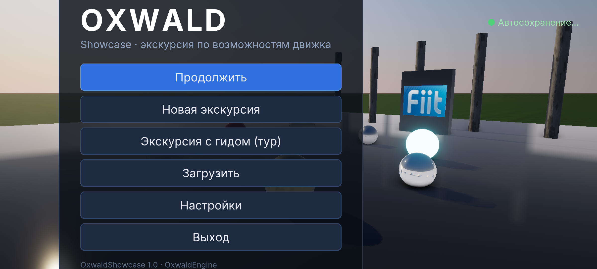

# 37. Android: сборка, запуск и отладка

> Модуль `android` (`engine/android`, только при сборке под Android), Gradle-проект `apps/android`, скрипты
> `tools/android/`. Платформонезависимая часть порта живёт в обычных модулях и тестируется на ПК:
> `<oxwald/runtime/touch_input.hpp>`, `<oxwald/runtime/app_lifecycle.hpp>`, `<oxwald/runtime/android_keymap.hpp>`,
> `<oxwald/core/asset_bundle.hpp>`, `<oxwald/render/mobile_quality.hpp>`. Заметки для разработчиков движка:
> [docs/dev/modules/android.md](../dev/modules/android.md).

OxwaldPlayer работает на Android 10+ (API 29) с драйвером Vulkan 1.2: телефоны на Snapdragon 8 Gen 1 и новее,
Dimensity/Exynos с Mali-G7xx/Immortalis/Xclipse и эмулятор Android Studio (AVD x86_64, Vulkan хоста через
gfxstream). Плеер — это `liboxwald_player.so`, который загружает `OxwaldActivity` (наследник `GameActivity` из
androidx.games). Внутри работает тот же `Engine`, что и на ПК: тот же рендерер, физика, Lua, UI и сеть.

## Что нужно

Всё ставится в `E:\Development` без прав администратора. Диск C: не используется: ни под SDK, ни под кэши Gradle,
ни под сборку.

| Что | Куда | Переменная окружения (пользовательская) |
| --- | --- | --- |
| JDK 17 (Temurin) | `E:\Development\Android\jdk` | `JAVA_HOME` |
| Android SDK: cmdline-tools, platform-tools, build-tools 35, platforms 34/35, CMake 3.31.6, emulator | `E:\Development\Android\sdk` | `ANDROID_HOME`, `ANDROID_SDK_ROOT` |
| NDK r28c (28.2.13676358) | `…\sdk\ndk\28.2.13676358` | `ANDROID_NDK_HOME`, `ANDROID_NDK_ROOT` |
| AVD `Oxwald_API35_x86_64` (Google APIs, API 35, x86_64, `hw.gpu.mode=host`) | `E:\Development\Android\avd` | `ANDROID_AVD_HOME` |
| Настройки adb/эмулятора, debug.keystore | `E:\Development\Android\user` | `ANDROID_USER_HOME`, `ANDROID_EMULATOR_HOME` |
| Кэш Gradle | `E:\Development\Android\gradle` | `GRADLE_USER_HOME` |
| Зависимости vcpkg под Android | `E:\Development\OxwaldEngine\vcpkg_installed_android` | — |
| Сборка (Gradle + CMake) | `E:\Development\OxwaldEngine\build\android` | `OX_ANDROID_BUILD_ROOT` (необязательно) |

Одна команда ставит всё это, создаёт AVD и прописывает переменные:

```powershell
tools/android/setup-toolchain.ps1
```

Затем соберите зависимости vcpkg под нужные ABI. `x64-android` нужен эмулятору, `arm64-android` нужен телефонам.
Первая сборка занимает 1–2 часа на ABI. Buildtrees, packages, downloads и двоичный кэш
(`E:\Development\vcpkg-cache`) лежат на E:.

```powershell
tools/android/vcpkg-install.ps1 -Triplet x64-android
tools/android/vcpkg-install.ps1 -Triplet arm64-android
```

Под Android в `vcpkg.json` отключены платформенными квалификаторами (`"platform": "!android"`) Vulkan loader (его
даёт система), validation layers (берутся из релиза Khronos, см. ниже), GLFW (окно даёт `GameActivity`), DLSS/NGX и
GLFW-биндинг ImGui. Qt входит в фичу по умолчанию `editor`, а Android-установка идёт с
`--x-no-default-features`. Набор пакетов для Windows от этого не меняется.

Слои валидации Vulkan для отладочных APK (NDK их больше не содержит):

```powershell
tools/android/fetch-validation-layers.ps1     # -> E:\Development\Android\vvl\<abi>\libVkLayer_khronos_validation.so
```

## Эмулятор

```powershell
tools/android/start-emulator.ps1             # без окна (-no-window): автоматизация, скриншоты, смоук-тест
tools/android/start-emulator.ps1 -Window     # с окном: мышь работает как палец
```

`-gpu host` отдаёт Vulkan гостя видеокарте хоста через gfxstream. На RTX 3080 гость видит устройство
«NVIDIA GeForce RTX 3080» с Vulkan 1.3.0 и всеми функциями, которые нужны движку (descriptor indexing, BDA,
timeline-семафоры, dynamic rendering, synchronization2). Проверить так:

```powershell
adb shell cmd gpu vkjson | Select-String deviceName,apiVersion
```

**Окно «could not automatically detect adb binary».** Эмулятор ищет adb сам и, если не находит, показывает
модальное окно. Пока оно открыто, автоматизация стоит. `setup-toolchain.ps1` и `start-emulator.ps1` вызывают
`tools/android/configure-emulator-adb.ps1`. Он прописывает путь к adb в настройках эмулятора
(`<ANDROID_EMULATOR_HOME>\Android Open Source Project\Emulator.conf`, секция `[set]`: `autoFindAdb=false`,
`adbPath=E:/Development/Android/sdk/platform-tools/adb.exe`), что то же самое, что Extended controls → Settings →
«Use detected ADB location» = off плюс свой путь. Кроме того, скрипт задаёт `ANDROID_EMULATOR_HOME`, а
`start-emulator.ps1` передаёт эмулятору `ANDROID_SDK_ROOT`. Для автоматических прогонов окно не нужно, поэтому по
умолчанию эмулятор стартует с `-no-window`.

## Сборка

```powershell
tools/android/build.ps1                                  # debug, x86_64, Showcase, установка на устройство
tools/android/build.ps1 -Abi arm64-v8a                   # для телефона
tools/android/build.ps1 -Abi all -BuildType Release      # оба ABI, release
tools/android/build.ps1 -NativeConfig Debug              # -O0: удобный пошаговый отладчик, но медленно
tools/android/build.ps1 -Sanitizer hwaddress -Abi arm64-v8a   # HWASan (Android 14+, arm64)
```

Скрипт делает три шага:

1. Готовит проект хостовым `oxpack.exe`: `samples/OxwaldShowcase` превращается в `OxwaldShowcase.oxpak`.
   Подойдёт `oxpack` из любой десктопной сборки. Другой проект задаётся через `-Project <dir>`, готовый пак через
   `-Pak <file>`.
2. Вызывает `gradlew assembleDebug|Release` в `apps/android` со свойствами `-PoxAbis`, `-PoxNativeConfig`,
   `-PoxSanitizer`, `-PoxPak`.
3. Ставит APK командой `adb install -r -t`.

Gradle-проект (AGP 8.7, Kotlin DSL, Gradle 8.11.1 через wrapper) собирает корневой `CMakeLists.txt` репозитория
через `externalNativeBuild`. Тулчейн там `vcpkg.cmake` с `VCPKG_CHAINLOAD_TOOLCHAIN_FILE` = тулчейн NDK. Триплет
берётся из `ANDROID_ABI` (`arm64-v8a` → `arm64-android`, `x86_64` → `x64-android`). Пакеты vcpkg ставятся заранее,
поэтому `VCPKG_MANIFEST_INSTALL=OFF`. Под Android CMake сам отключает редактор, тесты, `tools/` и DLSS и собирает
`OxwaldPlayer` как `liboxwald_player.so` вместе с игровым модулем Showcase. Ninja ограничен 4 потоками компиляции
(`build.ps1 -Jobs N`, свойство Gradle `oxJobs`, CMake-переменная `OX_ANDROID_JOBS`) и 2 одновременными линковками.

Зависимости собраны только в release (триплеты `x64-android`/`arm64-android` в `vcpkg-overlays/triplets` с
`VCPKG_BUILD_TYPE release`). При `-NativeConfig Debug` движок линкуется с release-библиотеками, а для Jolt
(`engine/physics/CMakeLists.txt`) конфигурация Debug отображается на Release вместе с его определениями (`NDEBUG`
и прочими): иначе раскладка классов Jolt в коде движка не совпала бы с библиотекой. В логе конфигурации CMake это
строка `Oxwald: Jolt has no Debug configuration…`. Остальной код движка в Debug собирается с `-O0` и проверками.

AGP упаковывает APK инкрементально и оставляет заменённые записи мёртвым местом внутри файла (APK на 140 МБ после
нескольких пересборок вырастал до 800+ МБ), поэтому `build.ps1` перед сборкой удаляет прошлый APK и
промежуточные файлы упаковки.

| Тип сборки | Нативная конфигурация | Что внутри |
| --- | --- | --- |
| `debug` | `RelWithDebInfo` (`-PoxNativeConfig=Debug` для `-O0`) | `debuggable`, библиотеки в APK урезаны (символы остаются в дереве сборки CMake, отладчик берёт их оттуда; `-PoxKeepSymbols=true` кладёт в APK неурезанную `liboxwald_player.so`, это ~760 МБ на x86_64), слои валидации, Tracy, удалённая консоль на порту 27015, подпись debug-ключом |
| `release` | `Release` | без Tracy и консоли, `profileable` для Perfetto/AGI; подпись ключом из `-PoxKeystore=… -PoxKeystorePassword=… -PoxKeyAlias=… -PoxKeyPassword=…`, без них debug-ключом (только для тестов) |

Что лежит в APK (`assets/`): `oxwald/engine/shaders` (GLSL, компилируются на устройстве через shaderc),
`oxwald/engine/ui/resources`, `project/<Имя>.oxpak`, индекс `oxindex.txt` (AAssetManager не умеет перечислять
каталоги) и штамп `oxbuild.txt`. При первом запуске после установки плеер распаковывает `oxwald/` и `project/`
во внутреннее хранилище (`/data/user/0/com.oxwald.player/files`): шейдерам нужны настоящие пути для `#include`,
пак открывается по пути. Если штамп не изменился, распаковка пропускается. Сами ассеты APK доступны в VFS как
`apk://` (`BundleMount`).

| Схема VFS | Android |
| --- | --- |
| `engine://` | `files/oxwald` (распакованные шейдеры и ресурсы UI) |
| `project://` | пак `files/project/*.oxpak` |
| `user://` | `files/user`: настройки, сохранения, `cache/` (SPIR-V, pipeline cache) |
| `apk://` | ассеты APK только для чтения, через AAssetManager |

## Запуск

```powershell
tools/android/run.ps1                                       # обычный запуск
tools/android/run.ps1 -PlayerArgs "--frames 600 --stats"    # любые опции десктопного плеера
tools/android/run.ps1 -Validation 1 -Logcat                 # слои валидации + поток логов
```

Аргументы передаются через intent extras, так что то же самое можно сделать без скриптов:

```sh
adb shell am start -S -n com.oxwald.player/.OxwaldActivity --es args "'--frames 300 --stats --quality low'" \
    --es validation 1 --ez wait_debugger false
```

| Extra | |
| --- | --- |
| `args` (строка) | командная строка плеера: `--scene`, `--cvar`, `--quality`, `--frames`, `--stats`, `--screenshot <png в user://>`, `--remote-console <порт>`, `-- <аргументы игры>` |
| `validation` (`1`/`0`) | `OX_VULKAN_VALIDATION`: включить или выключить слои (по умолчанию включены в debug) |
| `wait_debugger` (bool) | `android_main` ждёт до 120 с, пока к процессу не подключится отладчик |

Активность работает в ландшафтной ориентации (`sensorLandscape`) и на весь экран, системные панели вызываются
свайпом. При первом запуске качество выбирается по GPU, а не по десктопному бенчмарку
(`render::mobileQualityProfile`):

| GPU | Пресет | Апскейл | RT |
| --- | --- | --- | --- |
| Adreno 730+ (8 Gen 1–3, Adreno 750 в OnePlus 12), Mali-G710+, Immortalis, Xclipse | Medium | FSR 1 Quality (77 %) | выкл.; включается только при `VK_KHR_ray_query` и `allowRayTracing` |
| Старые Adreno/Mali, эмулятор, SwiftShader | Low | FSR 1 Balanced (59 %) | выкл. |

На большинстве Android-драйверов нет mesh-шейдеров, поэтому GPU-driven путь сам переходит на вершинный конвейер
(`r.GpuDriven.MeshShaders 0`). Выше Medium профиль не поднимается: телефоны ограничены нагревом, и стабильная
частота кадров важнее пиковой. Дальше игрок меняет настройки как обычно, и они сохраняются в `user://`.

## Ввод

`TouchInputMapper` переводит касания в обычные `InputEvent`, так что привязки Enhanced Input из `.oxproj` работают
без изменений:

| Жест | Во что превращается |
| --- | --- |
| Палец в левой половине | плавающий стик виртуального геймпада (слот 3): `Gamepad.LeftStick`, `Gamepad.LeftX/LeftY` |
| Палец справа (или второй палец слева) | движение мыши `Mouse.XY` и позиция курсора |
| Короткое касание (≤ 0.3 с, почти без сдвига) | клик `Mouse.Left` в точке касания (кнопки RmlUi/ImGui) |
| Экранные кнопки (по умолчанию Jump и Interact справа внизу) | `Gamepad.A` + `Key.Space`, `Gamepad.X` + `Key.E` |
| Щипок двумя пальцами | колесо мыши `Mouse.Wheel` |

Раскладку меняет `AndroidPlatform::touch().setLayout(TouchLayout{...})`: зоны задаются нормализованными
прямоугольниками, кнопки — именами источников. Геймпады (Bluetooth/USB: Xbox, DualSense, 8BitDo) занимают слоты
0–2 по id устройства. Стики читаются из осей X/Y и Z/RZ (или RX/RY), триггеры из LTRIGGER/RTRIGGER (или
BRAKE/GAS), крестовина из HAT. Аппаратная клавиатура и клавиатура хоста в эмуляторе дают `Key.*` и текстовый ввод.
Кнопка «Назад» работает как `Escape`.

## Жизненный цикл и звук

`AppLifecycle` получает события GameActivity и возвращает действия. Порядок событий на разных устройствах разный,
поэтому каждое событие меняет только свой флаг:

* **окно уничтожено** (пауза, сворачивание, иногда поворот): платформа обнуляет окно у
  `AndroidSurfaceProvider`, и рендер-поток на следующем `acquire` освобождает swapchain и `VkSurfaceKHR`.
  `APP_CMD_TERM_WINDOW` ждёт этого не дольше 3×100 мс, чтобы не вызвать ANR;
* **новое окно**: создаются новый surface и swapchain; устройство и все ресурсы остаются прежними;
* **пауза / потеря фокуса**: звук останавливается (`AudioEngine::setDeviceSuspended`, поток AAudio закрывается),
  зажатые кнопки отпускаются, настройки сохраняются (`onPause` — последний гарантированный вызов перед тем, как
  система может убить процесс);
* **без окна** игровой цикл не крутится: поток спит в `ALooper_pollOnce`.

Поворот экрана: swapchain всегда создаётся с `preTransform = IDENTITY`, поворот делает композитор. Android при этом
возвращает `VK_SUBOPTIMAL_KHR` на каждом present, и движок это игнорирует, если не совпадает только трансформация.
Pre-rotation (поворот проекции, `currentTransform`) пока не сделан: он экономит один проход композитора на
телефоне.

## Логи и падения

Лог движка идёт в logcat с тегом `Oxwald`, `printf`/`stdout` с тегом `OxwaldStdout`, падения с тегом
`OxwaldCrash`:

```powershell
tools/android/logcat.ps1 -Follow          # фильтр: Oxwald, OxwaldStdout, OxwaldCrash, vulkan, DEBUG, AndroidRuntime
tools/android/logcat.ps1 -App -Level W    # только процесс игры, предупреждения и выше
```

Обработчик сигналов (SIGSEGV/SIGBUS/SIGFPE/SIGILL/SIGABRT/SIGSYS, на отдельном стеке) пишет сигнал, адрес,
поток и стек вызовов (`_Unwind_Backtrace` + `dladdr`), а потом передаёт сигнал debuggerd, и система пишет обычный
tombstone (`adb bugreport`, на эмуляторе `adb shell ls /data/tombstones`). Символизировать стек:

```sh
adb logcat -d | $ANDROID_NDK_HOME/ndk-stack -sym E:/Development/OxwaldEngine/build/android/cxx/RelWithDebInfo/<hash>/x86_64/lib
```

## Отладка

### Android Studio

1. File → Profile or Debug APK → выберите `E:\Development\OxwaldEngine\build\android\gradle\app\outputs\apk\debug\app-debug.apk`.
   Можно и открыть `apps/android` как проект: тогда Studio сама соберёт CMake-часть, а точки останова ставятся
   прямо в исходниках движка.
2. Run → Edit Configurations → Debugger → Debug type: **Native Only** (или Dual для Java + C++). Если открывали
   APK, в Symbol Directories добавьте каталог с неурезанной `liboxwald_player.so`:
   `E:\Development\OxwaldEngine\build\android\cxx\RelWithDebInfo\<hash>\<abi>\lib`.
3. Подключиться к уже работающей игре: Run → Attach Debugger to Android Process → `com.oxwald.player` → Native.
   Чтобы поймать ранний код (`android_main`, инициализацию движка), запустите через
   `tools/android/run.ps1 -WaitDebugger` и подключитесь, пока плеер ждёт.
4. Для пошаговой отладки без «optimized out» соберите `-NativeConfig Debug` (`-O0`).

### LLDB из командной строки

`tools/android/debug.ps1` (и `debug.sh` для bash) делает то же, что Studio:

```powershell
tools/android/debug.ps1                                                  # интерактивный lldb, точка останова ox::Engine::tick
tools/android/debug.ps1 -Break "ox::render::RuntimeRenderer::render" -Batch   # остановиться, напечатать стек и переменные, отключиться
tools/android/debug.ps1 -Break "engine/runtime/src/engine.cpp:600"       # файл:строка
tools/android/debug.ps1 -NoLaunch                                        # подключиться к уже запущенной игре
```

Что происходит внутри:

1. `lldb-server` из NDK (`toolchains/llvm/prebuilt/windows-x86_64/lib/clang/19/lib/linux/<arch>/`) копируется в
   песочницу приложения через `run-as`. Поэтому нужен debuggable APK.
2. Игра стартует с `--ez wait_debugger true`.
3. Внутри песочницы запускается `lldb-server platform --listen unix-abstract:///com.oxwald.player/platform-oxwald.sock`.
4. Хостовый lldb из NDK (через `lldb.cmd`: он задаёт `PYTHONHOME` для встроенного Python, а голый `lldb.exe` не
   запускается с ошибкой «cannot open shared object file») выполняет `platform select remote-android`, `platform connect
   unix-abstract-connect://…`, добавляет путь к неурезанной библиотеке (`target.exec-search-paths`), подключается
   к PID, ставит точки останова и делает `continue`. Цикл ожидания в `android_main` видит `TracerPid` и
   продолжает работу.

ART использует SIGSEGV/SIGBUS в своих целях, поэтому скрипт отключает остановку на них
(`process handle … -s false`) и выключает JIT-загрузчик lldb (`plugin.jit-loader.gdb.enable off`): иначе процесс
останавливается на каждой регистрации JIT-кода ART. В режиме `-Batch` скрипт выбирает поток, который стоит на
точке останова, печатает его стек, переменные кадра и путь к символам и отключается. Если нужно поймать настоящее падение, уберите это правило в интерактивной сессии.

### Удалённая консоль, cvar'ы, Tracy

Debug-сборка слушает консоль движка на `127.0.0.1:27015` внутри устройства:

```powershell
tools/android/console.ps1                                   # интерактивно: help, stats, level …, r.ScreenPercentage 70
tools/android/console.ps1 -Command "stats","r.VSync 0"      # выполнить и выйти
```

В консоль также приходят строки лога уровня Info и выше. В release консоль включается аргументом
`--remote-console <порт>`.

Tracy (debug и RelWithDebInfo, `OX_ENABLE_TRACY=ON`): `tools/android/tracy.ps1` выполняет
`adb forward tcp:8086 tcp:8086`, после чего профайлер подключается к `127.0.0.1:8086`. Широковещательный поиск
клиентов через adb не проходит, поэтому адрес вводится вручную. Версия профайлера должна совпадать с портом vcpkg
(0.13.1).

Клиент Tracy стартует в статическом конструкторе библиотеки и на x86 без флага invariant TSC (эмулятор) вызывает
`exit(1)` ещё до `android_main`: процесс молча перезапускается по кругу. Поэтому `OxwaldActivity` до
`System.loadLibrary` задаёт `TRACY_NO_INVARIANT_CHECK=1`. `rdtsc` в эмуляторе работает, а на телефонах (arm64)
такой проверки нет.

### Вулкан: валидация и GPU-отладка

* **Слои валидации** лежат в debug-APK (`lib/<abi>/libVkLayer_khronos_validation.so`). Загрузчик Android
  находит их сам, потому что приложение debuggable. Ошибки валидации попадают в лог как `[vulkan]` с уровнем E.
  Отключить слои: `--es validation 0`.
* **RenderDoc for Android**: в RenderDoc на ПК выберите Replay Context → устройство Android. RenderDoc сам
  поставит свой серверный APK. Launch Application → `com.oxwald.player`. Слои валидации на время захвата лучше
  выключить. На эмуляторе захват работает через gfxstream, но надёжнее снимать на телефоне.
* **Android GPU Inspector (AGI)**: системный профайлинг (Perfetto: потоки CPU, частоты, счётчики GPU) и Frame
  Profiler. Работает на release-сборке благодаря `<profileable android:shell="true"/>`. Нужен телефон с
  поддержкой AGI (Adreno 6xx+/Mali-G7x+, OnePlus 12 подходит).
* **Snapdragon Profiler** (для Adreno): Realtime-метрики (загрузка GPU, % ALU/текстур, bandwidth, нагрев), Trace
  и Snapshot (захват кадра Vulkan). Подключается по adb к любому debuggable или profileable APK.
* **ASan/HWASan**: `build.ps1 -Sanitizer hwaddress -Abi arm64-v8a` (Android 14+, OnePlus 12) или
  `-Sanitizer address` (эмулятор x86_64 и любой arm64). Gradle добавляет `wrap.sh`, а для ASan ещё и рантайм
  `libclang_rt.asan-*.so`. Отчёты пишутся в logcat с тегом `wrap.sh`/`libc`.

### Тепловой режим (ADPF)

Плеер создаёт сессию `APerformanceHint` для игрового потока (цель 16.67 мс, каждый кадр сообщается фактическое
время `gameMs`) и пишет в лог смену теплового статуса `AThermal` с запасом до троттлинга (headroom). Функции
загружаются через `dlsym`, поэтому на API < 33 сессия просто не создаётся.

## Тесты

Логика порта без Android API проверяется обычными тестами на ПК: `TouchInput.*`, `AppLifecycle.*`,
`AndroidKeymap.*`, `LaunchCommandLine.*` в `ox_runtime_tests`, `AssetIndex.*`/`BundleMount.*` (APK-VFS на
поддельном AAssetManager) в `ox_core_tests`, `MobileQuality.*` в `ox_render_tests`.

Смоук-тест на устройстве запускает установленный APK на 300 кадров с валидацией. Он проверяет `exit code 0`,
число кадров, отсутствие ошибок `[vulkan]` и падений, а ещё сохраняет скриншот кадра от плеера и `adb screencap`:

```powershell
tools/android/smoke-test.ps1 -Frames 300
ctest --test-dir <десктопная сборка> -L android --output-on-failure   # пропускается (77), если нет устройства или APK
```

## OnePlus 12 (Snapdragon 8 Gen 3, Adreno 750, Android 14+)

1. Настройки → О телефоне → семь раз нажать «Номер сборки», затем Для разработчиков → Отладка по USB. Для
   Wi-Fi-отладки: «Беспроводная отладка» и `adb pair`.
2. `tools/android/vcpkg-install.ps1 -Triplet arm64-android`, затем `tools/android/build.ps1 -Abi arm64-v8a`.
3. `tools/android/smoke-test.ps1`. В логе должно быть `Device: Adreno (TM) 750 … Vulkan 1.3 | validation on`
   и `mobile GPU 'Adreno (TM) 750' (high-end tier): Medium preset, FSR 1 Quality`.
4. Что проверить в первую очередь:
   * экран 120 Гц: `Swapchain` выбирает FIFO, и частота кадров ограничена vsync. Для замеров используйте
     `--cvar r.VSync=0` (mailbox/immediate, если драйвер их даёт);
   * Adreno 750 поддерживает `VK_KHR_ray_query`. Трассировку можно попробовать вручную (`--cvar r.RayTracing=1`)
     и следить за нагревом через лог AThermal;
   * HWASan-сборка (`-Sanitizer hwaddress`) работает на Android 14+ без root;
   * Snapdragon Profiler: нагрузка GPU, bandwidth и нагрев при Medium/FSR 1;
   * кадр в RenderDoc, Perfetto-трейс в AGI с release-сборки;
   * поворот 90°/270° (Android сообщает `VK_SUBOPTIMAL_KHR`, движок это игнорирует), сворачивание и
     возврат, разделённый экран;
   * сравнить стоимость композиции поворота с pre-rotation, когда она появится.

## Проверено на AVD

Прогоны 14 и 15 октября 2026 года на машине разработки (RTX 3080, драйвер 617.42). Логи и скриншоты лежат в
`E:\Development\OxwaldEngine\build\android\smoke*`, `lldb-final.log` и `lldb-v2.log`.

**Эмулятор.** AVD `Oxwald_API35_x86_64`: профиль Pixel 7, экран 1080×2400 (420 dpi), 4 ГБ ОЗУ, 4 ядра, образ
`android-35/google_apis/x86_64`, `hw.gpu.mode=host`. Vulkan в гостевой системе пробрасывается на GPU хоста через
gfxstream. Строки из logcat при запуске:

```
[rhi] Device: NVIDIA GeForce RTX 3080 | 617.42 | Vulkan 1.3 | validation on | frames in flight 2
[rhi] swapchain 2400x1080 3 images, format 43, present mode fifo, display transform 0x2 (compositor rotates)
[render] recommended settings: mobile GPU 'NVIDIA GeForce RTX 3080' (low tier): Low preset, FSR 1 Balanced (58 %), ray tracing unsupported, vertex pipeline (no mesh shaders)
[android] extracted 211 files (54.6 MB) from the APK in 837 ms
```

RTX 3080 за gfxstream не даёт `VK_KHR_ray_query` и mesh-шейдеров, поэтому `mobileQualityProfile()` выбирает
нижний уровень. Поворот экрана делает композитор (`display transform 0x2`).

**Смоук-тест** (`tools/android/smoke-test.ps1`, сцена Showcase из `OxwaldShowcase.oxpak` внутри APK):

| Сборка нативного кода | Кадров | Валидация | Сообщений `[vulkan]` | Код выхода |
| --- | --- | --- | --- | --- |
| RelWithDebInfo | 300 | вкл. | 0 | 0 |
| Debug | 120 | вкл. | 0 | 0 |
| Debug | 300 | вкл. | 0 | 0 |
| RelWithDebInfo, первый запуск после установки | 300 | вкл. | 0 | 0 |
| RelWithDebInfo | 600 | выкл. | 0 | 0 |
| RelWithDebInfo, сборка 14 октября (`smoke-final`) | 300 | вкл. | 0 | **3** — не записался `--screenshot` плеера |
| RelWithDebInfo, сборка 15 октября, прогоны 1–4 (`smoke-v2-1` … `smoke-v2-4`) | 300 | вкл. | 0 | 0 |

Во всех прогонах нет ошибок слоя валидации и падений. Приложение проходит жизненный цикл до конца: Pause →
WindowDestroyed (`window released by the renderer: yes`) → Stop → Destroy → `android_main finished`. Частота кадров
в эмуляторе (12–60 кадров/с в зависимости от сборки и валидации) не говорит о производительности на телефоне, поэтому
в таблице её нет.

**Код выхода 3 в `smoke-final`.** Плеер не записал свой скриншот (`screenshot
/data/user/0/com.oxwald.player/files/user/smoke.png FAILED`), а `adb screencap` в том же прогоне получился. Путь и
права ни при чём: тот же файл записывался в пяти прогонах до этого. Причина — гонка потоков в `RuntimeRenderer`.
Плеер ставит запрос скриншота из игрового потока перед последним кадром, а поток рендера в это время ещё рисует
предыдущий кадр. Рендерер смотрел в очередь запросов дважды за кадр: в середине кадра (нужна ли текстура для
захвата) и в конце (что записать). Запрос, пришедший между этими моментами, забирался в конце кадра без текстуры
захвата, и колбэк получал `false` без сообщения в логе. В сборке 14 октября игровой поток стал быстрее (53,7
кадра/с против 12–35 в прошлых прогонах), и запрос попал в это окно.

Исправление: рендерер забирает запросы один раз за кадр, до отрисовки. Запрос, который пришёл позже, ждёт
следующего кадра, а поток рендера при остановке дорисовывает очередь. Если же после запроса не нарисовано ни одного
кадра (например, окно свёрнуто), `shutdown()` рендерера сообщает об ошибке в лог и вызывает колбэк с `false`.
Регрессионные тесты на Windows: `UiEngine.WindowedScreenshotsWhileRenderingOnTheRenderThread` (24 запроса
подряд при рендере в отдельном потоке) и `UiEngine.ScreenshotRequestedAfterTheLastFrameFailsAtShutdown`.
После исправления четыре прогона по 300 кадров подряд (сборка 15 октября, пак пересобран `oxpack` из текущего
дерева) завершились с кодом 0: в каждом есть `screenshot … written`, 0 сообщений `[vulkan]`, без падений.



Снимок `adb screencap` из последнего прогона: главное меню Showcase (RmlUi) поверх сцены хаба, 2400×1080.

**LLDB** (`tools/android/debug.ps1 -Batch`, точка останова на `ox::Engine::tick`). lldb подключается к процессу,
останавливается в игровом потоке и печатает стек до `android_main`:

```
* thread #20, name = 'Thread-4', stop reason = breakpoint 1.1
  * frame #0: liboxwald_player.so`ox::Engine::tick() [inlined] ox::Clock::timePoint() at time.hpp:16:57
    frame #1: liboxwald_player.so`ox::Engine::tick(this=0x000074f222674a40) at engine.cpp:583:22
    frame #2: liboxwald_player.so`::android_main(android_app *) [inlined] (anonymous namespace)::runPlayer(app=..., platform=...) at android_main.cpp:181:21
    frame #3: liboxwald_player.so`android_main(app=0x000074f309e4f850) at android_main.cpp:208:16
    frame #4: liboxwald_player.so`android_app_entry(param=0x000074f309e4f850) at android_native_app_glue.c:237:3
    frame #5: libc.so`__pthread_start(void*) + 59
```

Символы `liboxwald_player.so` берутся из дерева сборки (`target.exec-search-paths`), потому что в APK лежит урезанная
библиотека. Перед остановкой lldb показывает несколько `SIGBUS` в потоках ART. Это обычные сигналы среды выполнения,
скрипт пропускает их без остановки (`process handle SIGSEGV SIGBUS ... -s false`).

15 октября проверка повторена на новой сборке (`lldb-v2.log`): остановка в `ox::Engine::tick` (`engine.cpp:578`),
стек через `runPlayer` (`android_main.cpp:184`) до `android_main` (`android_main.cpp:211`). Два исправления в
`debug.ps1`. В первом прогоне `-Batch` выбрал не тот поток и напечатал стек потока перенаправления stdout: поток
на точке останова теперь ищется через `SBProcess` текущей цели и выбирается по его номеру. Вывод скрипта можно
перенаправить в файл (`debug.ps1 -Batch *> lldb.log`): раньше Windows PowerShell 5.1 обрывал скрипт на строке
прогресса `adb push` в stderr.

**arm64.** APK для телефонов (`arm64-v8a`, 132.9 МБ; пересобран 15 октября вместе с исправлением скриншота)
собран (`tools/android/build.ps1 -Abi arm64-v8a`), но на
устройстве ещё не запускался: 15 октября 2026 года `adb devices` не показывает ни одного устройства. Чек-лист для
первого запуска — в разделе [OnePlus 12](#oneplus-12-snapdragon-8-gen-3-adreno-750-android-14).
